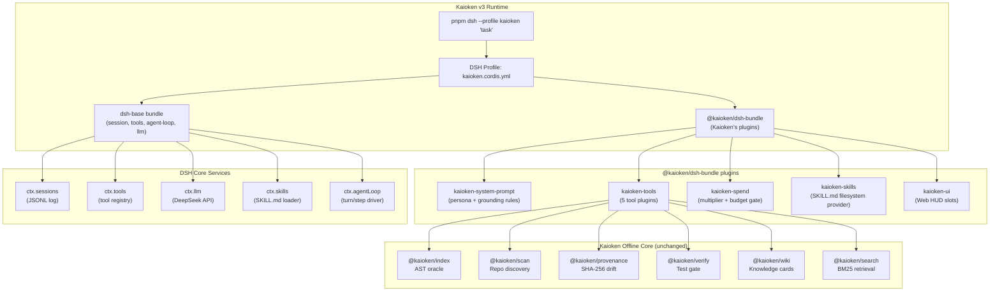

# Kaioken v3 on DeepSeek Harness — Implementation Plan

## Goal

Replace the Pi agent harness with **DeepSeek Harness (DSH)** as Kaioken's agent runtime, while keeping the entire Kaioken offline knowledge engine (AST oracle, provenance, skills, verify, wiki, spend governance) intact — now surfaced as **DSH tool plugins** available in both the Web UI and CLI. This produces **Kaioken v3**: a full DSH profile with the Kaioken design system, ANSI-orange HUD, and all 5 knowledge capabilities wired directly into the DSH agent loop.

---

## Architecture Decision: Why "Full DSH Profile + Kaioken Bundle"

This is the best option because:

| Criterion | Pi Extension | DSH Plugin Bundle (chosen) |
|---|---|---|
| **Agent loop** | Inherited from Pi — limited seam | DSH's `agent/request` waterfall — full control |
| **Session durability** | Pi owns it, Kaioken can't extend | DSH JSONL + SQLite — Kaioken can emit custom session events |
| **LLM abstraction** | Pi's `Models` API only | DSH `ctx.llm` seam — any provider, swappable |
| **UI extensibility** | Pi TUI only | DSH Web (`packages/client`) + CLI headless |
| **Skills** | `SKILL.md` via Kaioken's own loader | DSH `ctx.skills` seam — natively integrated |
| **Multiplier / spend** | Kaioken's `modelport` governs spend | Wire into DSH `ctx.credentials` + custom budget plugin |
| **Multi-agent** | Limited | DSH `ctx.subagents` (spawn/fork/ACP/SDK) |

---

## User Review Required

> [!IMPORTANT]
> **Breaking change**: Kaioken's dependency on `@earendil-works/pi-ai` (Pi harness) is dropped entirely. The `kaioken-pi` extension and `.pi/` directory structure are no longer the primary runtime. The offline core (`@kaioken/index`, `@kaioken/scan`, `@kaioken/modelport`, etc.) is preserved as-is.

> [!WARNING]
> **DEEPSEEK_API_KEY required**: DSH's default LLM provider uses the DeepSeek API. We will wire Kaioken's `modelport` spend governance on top of it. If you want to keep using Pi as the LLM, we can implement a `dsh-llm-pi-ai` provider adapter instead — say the word.

> [!NOTE]
> The `deepseek-harness` repo ships as a pnpm workspace. We will create a new top-level workspace directory `kaioken-dsh/` (sibling to `deepseek-harness/`) that imports DSH packages as dependencies. We do **not** fork or modify `deepseek-harness/`. This keeps Kaioken's DSH dependency upgradeable.

---

## Open Questions

> [!IMPORTANT]
> **Q1: LLM provider choice** — Keep DeepSeek API as the default (easiest), or write a `dsh-llm-pi-ai` adapter so all model calls still go through Pi's `Models` registry? The plan below defaults to DeepSeek API.

> [!IMPORTANT]
> **Q2: Monorepo location** — Should the Kaioken v3 workspace live at `d:\project\ai_now_know\kaioken-dsh\` (new, clean), or should we convert the existing `kaio_base` directory in-place?

---

## System Architecture



---

## Proposed Changes

### Phase 1 — Workspace Scaffold

**Create `d:\project\ai_now_know\kaioken-dsh\` as a new pnpm workspace.**

---

#### [NEW] `kaioken-dsh/package.json`

```json
{
  "name": "kaioken-dsh",
  "private": true,
  "type": "module",
  "engines": { "node": ">=22.19.0" },
  "scripts": {
    "dev:web": "pnpm --filter @kaioken/dsh-app dsh web",
    "dev:cli": "pnpm --filter @kaioken/dsh-app dsh headless",
    "typecheck": "tsc -p tsconfig.json --noEmit",
    "build": "pnpm --filter @kaioken/dsh-* -r build",
    "test": "vitest run"
  },
  "devDependencies": {
    "typescript": "^5.9.3",
    "@types/node": "^22.0.0",
    "vitest": "^3.0.0"
  }
}
```

#### [NEW] `kaioken-dsh/pnpm-workspace.yaml`

```yaml
packages:
  - "plugins/*"        # @kaioken/dsh-* Cordis plugins
  - "app"              # kaioken profile app
```

---

### Phase 2 — Kaioken DSH Plugin Packages

Each plugin is a standalone npm package under `kaioken-dsh/plugins/`.

---

#### [NEW] `plugins/kaioken-system-prompt/`

**Purpose**: Hooks `system-prompt/assemble` waterfall to inject Kaioken's grounding rules, persona, and offline invariants into every model request.

```typescript
// plugins/kaioken-system-prompt/src/index.ts
import { Service, type Context } from '@deepseek-ai/cordis'

export class KaiokenSystemPromptPlugin extends Service {
  static inject = ['systemPrompt'] as const

  constructor(ctx: Context) {
    super(ctx, 'kaiokenSystemPrompt')

    ctx.on('system-prompt/assemble', async (sections, next) => {
      sections.push({
        id: 'kaioken-grounding',
        priority: 100,  // high priority — runs before other sections
        content: KAIOKEN_GROUNDING_PROMPT,
      })
      return next(sections)
    })
  }
}

const KAIOKEN_GROUNDING_PROMPT = `
## Kaioken Grounding Rules (NON-NEGOTIABLE)

You are running inside Kaioken — a deterministic grounding layer.
- NEVER quote code unless you verified it with the kaioken_symbol or kaioken_search tool first.
- NEVER claim a symbol exists without calling kaioken_symbol.
- NEVER mark a task complete without calling kaioken_verify.
- Always call kaioken_status before any documentation task.
- Use the multiplier parameter (1-10) to control depth. Default is 1.
`.trim()
```

---

#### [NEW] `plugins/kaioken-tools/`

**Purpose**: Registers all 5 Kaioken knowledge tools into `ctx.tools` so the DSH agent loop can call them.

Each tool wraps the existing `@kaioken/*` offline packages (imported from `kaio_base/`).

```typescript
// plugins/kaioken-tools/src/index.ts
import { Service, type Context } from '@deepseek-ai/cordis'
import { buildIndex, readIndexArtifact, SymbolOracle } from '@kaioken/index'
import { scan, readScanArtifact } from '@kaioken/scan'
import { gatherProvenance, checkDrift } from '@kaioken/provenance'
import { runVerify } from '@kaioken/verify'
import { bm25Search } from '@kaioken/search'

export class KaiokenToolsPlugin extends Service {
  static inject = ['tools'] as const

  constructor(ctx: Context) {
    super(ctx, 'kaiokenTools')

    // Tool 1: kaioken_status — zero-token staleness check
    ctx.effect(() => ctx.tools.register({
      name: 'kaioken_status',
      description: 'Check staleness of the AST index and provenance in milliseconds. Zero tokens spent. Run before any code documentation task.',
      inputSchema: {
        type: 'object',
        properties: {
          root: { type: 'string', description: 'Repository root path (default: cwd)' }
        }
      },
      async execute({ root = process.cwd() }) {
        const [scan, drift] = await Promise.all([
          readScanArtifact(root).catch(() => null),
          checkDrift(root).catch(() => null),
        ])
        return JSON.stringify({ scan, drift })
      }
    }))

    // Tool 2: kaioken_symbol — AST symbol oracle lookup
    ctx.effect(() => ctx.tools.register({
      name: 'kaioken_symbol',
      description: 'Look up the exact declaration, source file, and line range of a symbol. Returns null if the symbol does not exist — "does not exist" is a verified answer.',
      inputSchema: {
        type: 'object',
        required: ['name'],
        properties: {
          name: { type: 'string', description: 'Symbol name (function, class, type, variable)' },
          root: { type: 'string' }
        }
      },
      async execute({ name, root = process.cwd() }) {
        const artifact = await readIndexArtifact(root)
        const oracle = new SymbolOracle(artifact)
        const result = oracle.lookup(name)
        return JSON.stringify(result ?? { exists: false, name })
      }
    }))

    // Tool 3: kaioken_search — BM25 lexical search
    ctx.effect(() => ctx.tools.register({
      name: 'kaioken_search',
      description: 'Lexical BM25 search across codebase files, symbols, and documentation.',
      inputSchema: {
        type: 'object',
        required: ['query'],
        properties: {
          query: { type: 'string' },
          limit: { type: 'number', default: 8 },
          root: { type: 'string' }
        }
      },
      async execute({ query, limit = 8, root = process.cwd() }) {
        const results = await bm25Search(root, query, { limit })
        return JSON.stringify(results)
      }
    }))

    // Tool 4: kaioken_verify — native test gate
    ctx.effect(() => ctx.tools.register({
      name: 'kaioken_verify',
      description: 'Run the native test suite (npm test, pytest, go test, cargo test). Returns pass/fail. Agents cannot self-certify completion without this.',
      inputSchema: {
        type: 'object',
        properties: {
          root: { type: 'string' },
          timeout: { type: 'number', default: 120000 }
        }
      },
      async execute({ root = process.cwd(), timeout = 120_000 }) {
        const result = await runVerify(root, { timeout })
        return JSON.stringify(result)
      }
    }))

    // Tool 5: kaioken_scan — repo inventory + risk
    ctx.effect(() => ctx.tools.register({
      name: 'kaioken_scan',
      description: 'Run a full deterministic repo inventory: file tree, AST symbol index, entropy risk flags. Saves to .kaioken/. Takes ~seconds.',
      inputSchema: {
        type: 'object',
        properties: {
          root: { type: 'string' },
          progress: { type: 'boolean', default: false }
        }
      },
      async execute({ root = process.cwd(), progress = false }) {
        const result = await scan(root, { progress })
        return JSON.stringify({ files: result.files.length, symbols: result.symbols.length })
      }
    }))
  }
}
```

---

#### [NEW] `plugins/kaioken-spend/`

**Purpose**: Wraps Kaioken's `@kaioken/modelport` spend governance into a DSH plugin. Hooks `agent/request` waterfall to enforce the multiplier dial and budget ceiling before any model call.

```typescript
// plugins/kaioken-spend/src/index.ts
import { Service, type Context } from '@deepseek-ai/cordis'
import { depthFor, parseMultiplier } from '@kaioken/modelport'
import { BudgetCeilingManager } from '@kaioken/modelport'

export interface KaiokenSpendConfig {
  defaultMultiplier: number   // 1-10, default 1
  budgetCeilingUsd: number    // e.g. 1.00
}

export class KaiokenSpendPlugin extends Service {
  static inject = ['agents'] as const

  declare config: KaiokenSpendConfig
  private budget: BudgetCeilingManager

  constructor(ctx: Context, config: KaiokenSpendConfig) {
    super(ctx, 'kaiokenSpend')
    this.config = config
    this.budget = new BudgetCeilingManager(config.budgetCeilingUsd)

    // Intercept every model request to apply multiplier limits
    ctx.on('agent/request', async (request, next) => {
      const multiplier = this.config.defaultMultiplier
      const depth = depthFor(multiplier)

      // Apply token ceiling from multiplier dial
      request.maxOutputTokens = Math.min(
        request.maxOutputTokens ?? Infinity,
        depth.maxOutputTokens
      )

      return next(request)
    })
  }

  static schema = {
    defaultMultiplier: { default: 1 },
    budgetCeilingUsd: { default: 1.00 }
  }
}
```

---

#### [NEW] `plugins/kaioken-skills/`

**Purpose**: Mounts Kaioken's `.kaioken/skills/` directory into DSH's native `ctx.skills` seam, so all Kaioken SKILL.md procedures appear in the agent's skill catalog.

```typescript
// plugins/kaioken-skills/src/index.ts
import { Service, type Context } from '@deepseek-ai/cordis'
import { join } from 'node:path'
import { STANDARD_SKILL_DIRS } from '@kaioken/skills'

export class KaiokenSkillsPlugin extends Service {
  static inject = ['skills'] as const

  constructor(ctx: Context) {
    super(ctx, 'kaiokenSkills')

    // Register each Kaioken skill directory with the DSH skill seam
    for (const dir of STANDARD_SKILL_DIRS) {
      ctx.effect(() => ctx.skills.addDirectory(dir))
    }
  }
}
```

---

#### [NEW] `plugins/kaioken-ui/`

**Purpose**: Registers custom Web UI slots into `packages/client` slot system. Adds the Kaioken HUD chrome: orange accent, CRT scanlines class, multiplier dial, spend indicator, verification badge.

```typescript
// plugins/kaioken-ui/src/index.ts
// Web (browser-side) plugin — registered via the dsh-web-app bundle
import { Service, type Context } from '@deepseek-ai/cordis'

export class KaiokenUiPlugin extends Service {
  constructor(ctx: Context) {
    super(ctx, 'kaiokenUi')

    // Inject Kaioken CSS design tokens into the page
    ctx.effect(() => {
      const style = document.createElement('style')
      style.textContent = KAIOKEN_CSS_TOKENS
      document.head.appendChild(style)
      return () => style.remove()
    })
  }
}

const KAIOKEN_CSS_TOKENS = `
:root {
  --kai-orange: #ff8700;
  --kai-amber: #ffaf00;
  --kai-red: #ff0000;
  --kai-tan: #d7af87;
  --kai-blue: #87d7ff;
  --kai-green: #00d787;
  --kai-sage: #87af87;
  --kai-rose: #ff5f5f;
  --dsh-accent: var(--kai-orange);
  --dsh-accent-secondary: var(--kai-amber);
}
`.trim()
```

---

### Phase 3 — Kaioken Bundle + Profile

#### [NEW] `app/package.json`

```json
{
  "name": "@kaioken/dsh-app",
  "version": "3.0.0",
  "private": true,
  "type": "module",
  "dsh": {
    "profile": {
      "bundles": ["@deepseek-ai/dsh-base", "@kaioken/dsh-bundle"]
    }
  },
  "dependencies": {
    "@deepseek-ai/dsh": "workspace:*",
    "@kaioken/dsh-bundle": "workspace:*"
  }
}
```

#### [NEW] `plugins/kaioken-bundle/`

The bundle package declares the plugin tree:

```yaml
# plugins/kaioken-bundle/kaioken.patch.yml
- id: kaioken-system-prompt
  name: "@kaioken/dsh-system-prompt"
  config:
    enabled: true

- id: kaioken-tools
  name: "@kaioken/dsh-tools"
  config:
    enabled: true

- id: kaioken-spend
  name: "@kaioken/dsh-spend"
  config:
    defaultMultiplier: 1
    budgetCeilingUsd: 5.00

- id: kaioken-skills
  name: "@kaioken/dsh-skills"
  config:
    enabled: true
```

#### [NEW] `app/kaioken.cordis.yml`

```yaml
# The Kaioken v3 profile
extends:
  - "@deepseek-ai/dsh-base"
  - "@kaioken/dsh-bundle"

patch:
  - id: kaioken-ui
    name: "@kaioken/dsh-ui"
    config:
      theme: dark
```

---

### Phase 4 — Link kaio_base packages

The offline core packages (`@kaioken/index`, `@kaioken/scan`, etc.) live in `kaio_base/kaioken/`. We reference them via workspace protocol from `kaioken-dsh`:

#### [MODIFY] `kaioken-dsh/pnpm-workspace.yaml`

```yaml
packages:
  - "plugins/*"
  - "app"
  - "../kaio_base/kaioken/*"   # link existing offline core
```

This means `@kaioken/index`, `@kaioken/modelport`, etc. are available as workspace deps with zero duplication.

---

## File Structure After Implementation

```
d:\project\ai_now_know\
├── deepseek-harness/           # DSH upstream (unmodified)
├── kaio_base/                  # Kaioken offline core (unchanged)
│   └── kaioken/                # @kaioken/* packages
└── kaioken-dsh/                # NEW: Kaioken v3 workspace
    ├── package.json
    ├── pnpm-workspace.yaml
    ├── tsconfig.json
    ├── app/                    # @kaioken/dsh-app (profile entry)
    │   ├── package.json
    │   └── kaioken.cordis.yml
    └── plugins/
        ├── kaioken-system-prompt/   # @kaioken/dsh-system-prompt
        │   ├── package.json
        │   └── src/index.ts
        ├── kaioken-tools/           # @kaioken/dsh-tools (5 tools)
        │   ├── package.json
        │   └── src/index.ts
        ├── kaioken-spend/           # @kaioken/dsh-spend
        │   ├── package.json
        │   └── src/index.ts
        ├── kaioken-skills/          # @kaioken/dsh-skills
        │   ├── package.json
        │   └── src/index.ts
        ├── kaioken-ui/              # @kaioken/dsh-ui
        │   ├── package.json
        │   └── src/index.ts
        └── kaioken-bundle/          # @kaioken/dsh-bundle
            ├── package.json
            └── kaioken.patch.yml
```

---

## Implementation Phases & Milestones

| Phase | Deliverable | Estimated Effort |
|---|---|---|
| **Phase 1** | `kaioken-dsh/` workspace scaffold with pnpm linking to DSH + kaio_base | 1 session |
| **Phase 2** | `kaioken-tools` plugin — all 5 tools registered, DSH agent can call them | 1 session |
| **Phase 3** | `kaioken-system-prompt` + `kaioken-spend` plugins — grounding rules + multiplier dial | 1 session |
| **Phase 4** | `kaioken-skills` plugin — SKILL.md catalog in DSH skill seam | 0.5 session |
| **Phase 5** | `kaioken-bundle` + profile — `pnpm dsh --profile kaioken "task"` works end-to-end | 1 session |
| **Phase 6** | `kaioken-ui` — Kaioken HUD design tokens, orange accent in Web UI | 1 session |
| **Phase 7** | Integration tests + snapshot tests for all 5 tools | 1 session |

---

## Verification Plan

### Phase 1-2 Verification (Tools)

```bash
# Scaffold workspace
cd d:\project\ai_now_know\kaioken-dsh
pnpm install

# Typecheck all plugins
pnpm typecheck

# Run DSH with Kaioken profile (headless)
set DEEPSEEK_API_KEY=sk-...
pnpm dsh --profile kaioken "what symbols are exported from kaio_base/kaioken/index/src/index.ts"
# Expected: agent calls kaioken_symbol tool, returns real symbol data
```

### Phase 3 Verification (Grounding + Spend)

```bash
# Verify grounding prompt appears in system prompt
pnpm dsh --profile kaioken --dump-config

# Verify multiplier caps token output
pnpm dsh --profile kaioken "explain the entire codebase at multiplier x1"
# Expected: output stays within depthFor(1).maxOutputTokens = 2400 tokens
```

### Phase 5 Verification (Web UI)

```bash
# Launch web with Kaioken profile
pnpm dsh --profile kaioken web
# Navigate to http://127.0.0.1:3080
# Expected:
#   - Orange accent color replaces DSH blue
#   - Tool calls show kaioken_* tool names in conversation
#   - Skills panel shows .kaioken/skills/ entries
```

### Phase 7 Verification (Tests)

```bash
# Unit tests for each plugin
pnpm test

# Snapshot test: agent response with grounding tools must cite kaioken_symbol
pnpm dsh --profile kaioken "what does buildIndex do in @kaioken/index"
# Expected: agent calls kaioken_symbol("buildIndex"), not hallucinate
```

### Manual Verification

1. ✅ `kaioken_status` returns index freshness in <50ms with zero model tokens
2. ✅ `kaioken_symbol("nonExistentFunction")` returns `{ exists: false }`, not a hallucination
3. ✅ `kaioken_verify` runs `npm test` in kaio_base and reports pass/fail
4. ✅ DSH session log (`session.v4.jsonl`) contains `kaioken_*` tool call events
5. ✅ Web UI shows orange `--kai-orange: #ff8700` accent throughout
6. ✅ `pnpm dsh --profile headless kaioken "task"` works from terminal

---

## Key Risks & Mitigations

| Risk | Mitigation |
|---|---|
| DSH is pre-stable — API changes | Pin exact DSH version in `package.json`; use `workspace:~` for vendor |
| `@kaioken/verify` spawns subprocess — needs `ctx.subprocess` seam | Wrap via DSH's `ctx.subprocess` instead of calling `child_process` directly |
| `kaioken-ui` requires browser context — can't load in headless | Guard with `typeof document !== 'undefined'` — already standard in DSH client plugins |
| Spending governance blocks might conflict with DSH's own guard plugins | Give `kaioken-spend` lower priority than DSH's `dsh-guard` — configure load order in bundle |
| `pnpm-workspace.yaml` cross-repo linking (`../kaio_base`) may break on CI | Add CI step to install both workspaces; or copy built `dist/` instead |
