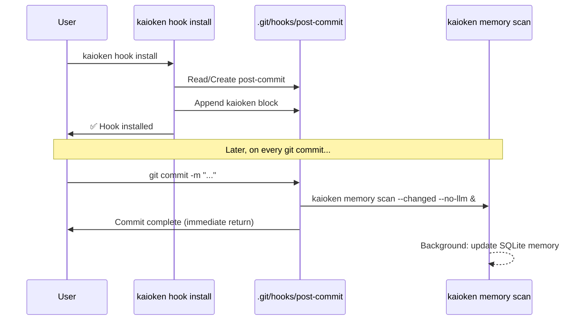

# 12. `kaioken hook install` — Git Post-Commit Hook Installer

> **Status**: 🟢 Implemented (Phase 17)
> **CLI Entry**: `kaioken hook install`, `kaioken hook uninstall`, `kaioken hook status`
> **Source Modules**: `src/cli/hook.rs`, `src/hook/mod.rs`

---

## 1. Purpose & Motivation

`kaioken hook install` automates the installation of a **non-blocking Git post-commit hook** that triggers `kaioken memory scan --changed` after every commit. This ensures the agent's structured memory stays continuously synchronized with the repository's evolving state — without requiring manual intervention.

The hook must be:
- **Non-blocking**: `git commit` returns immediately; the scan runs in a background process.
- **Idempotent**: Running `install` multiple times is safe and won't duplicate hook content.
- **Composable**: If a `post-commit` hook already exists, kaioken's block is appended without overwriting existing hooks.

---

## 2. Hook File Specification

### 2.1 Target File

```
<repo_root>/.git/hooks/post-commit
```

### 2.2 Generated Hook Content

```bash
#!/bin/sh
# === KAIOKEN AGENT HOOK START ===
# Auto-installed by `kaioken hook install`
# Non-blocking post-commit memory synchronization
# To uninstall: kaioken hook uninstall (or delete this block)

if command -v kaioken >/dev/null 2>&1; then
    kaioken memory scan --changed --no-llm >/dev/null 2>&1 &
    disown 2>/dev/null || true
fi

# === KAIOKEN AGENT HOOK END ===
```

### 2.3 Key Design Decisions

| Decision | Rationale |
|----------|-----------|
| `& disown` pattern | Detaches scan from the Git process; commit returns immediately |
| `command -v` guard | Gracefully no-ops if `kaioken` binary isn't on PATH |
| `--no-llm` default | Commit hooks must be zero-cost (no API calls) |
| Redirect to `/dev/null` | Prevents scan output from polluting commit terminal |
| Sentinel comments | `HOOK START`/`HOOK END` markers enable reliable uninstall |

---

## 3. CLI Interface

```text
kaioken hook
├── install     # Install the post-commit hook
│   ├── --force     # Overwrite existing kaioken hook block
│   └── --shell     # Override shell interpreter (default: /bin/sh)
├── uninstall   # Remove the kaioken hook block (preserves other hooks)
└── status      # Check if the hook is installed and healthy
```

### 3.1 CLI Args

```rust
#[derive(Subcommand)]
pub enum HookCommands {
    /// Install the kaioken post-commit hook
    Install(HookInstallArgs),
    /// Remove the kaioken hook block
    Uninstall,
    /// Check hook installation status
    Status,
}

#[derive(clap::Args)]
pub struct HookInstallArgs {
    /// Overwrite existing kaioken hook block if present
    #[arg(long)]
    pub force: bool,
    /// Shell interpreter path (default: /bin/sh)
    #[arg(long, default_value = "/bin/sh")]
    pub shell: String,
}
```

---

## 4. Installation Algorithm

```text
1. Resolve repo root via `git rev-parse --show-toplevel`
2. Locate hook file: `<repo_root>/.git/hooks/post-commit`
3. IF file exists:
   a. Read contents
   b. Check for `=== KAIOKEN AGENT HOOK START ===` marker
   c. IF marker found AND --force NOT set → print "Already installed" and exit 0
   d. IF marker found AND --force set → replace existing block
   e. IF marker NOT found → append kaioken block after existing content
4. IF file does NOT exist:
   a. Create file with shebang + kaioken block
5. Set file permissions: chmod +x (Unix) or no-op (Windows)
6. Verify: read back file and confirm marker presence
7. Print success message
```

### 4.1 Windows Considerations

On Windows:
- Git for Windows supports shell hooks via its bundled MSYS2/MinGW
- The hook file path uses forward slashes internally
- `chmod` is replaced by ensuring the file has no read-only attribute
- Alternative: generate a `.bat` hook or rely on Git Bash

---

## 5. Architecture & Integration Points

### 5.1 Module Layout

```text
src/
├── cli/
│   ├── mod.rs     ← Add `Hook(HookCommands)` variant to Commands enum
│   └── hook.rs    ← NEW: Hook install/uninstall/status handlers
├── scanner/
│   └── git.rs     ← Reuse `get_repo_root()` for hook path resolution
```

### 5.2 Data Flow



### 5.3 Dependencies

- **Existing**: `std::fs`, `std::os::unix::fs::PermissionsExt` (Unix), `scanner::git::get_repo_root()`
- **No new crate dependencies**

---

## 6. Uninstall Behavior

`kaioken hook uninstall` performs:
1. Open `.git/hooks/post-commit`
2. Find text between `=== KAIOKEN AGENT HOOK START ===` and `=== KAIOKEN AGENT HOOK END ===` markers
3. Remove that block (including markers)
4. If the file is now empty (or just a shebang), delete it
5. Print confirmation

---

## 7. Status Check

`kaioken hook status` reports:

```text
🔗 Git Hook Status
═══════════════════
  Hook file:   .git/hooks/post-commit
  Exists:      ✅ Yes
  Kaioken:     ✅ Installed (sentinel markers found)
  Executable:  ✅ Yes
  Binary path: /usr/local/bin/kaioken (on PATH)
```

---

## 8. Testing Strategy

| Test | Description |
|------|-------------|
| `test_hook_install_fresh` | No existing hook → creates file with correct content and permissions |
| `test_hook_install_existing` | Pre-existing hook content → appends without overwriting |
| `test_hook_install_idempotent` | Run install twice → no duplication of kaioken block |
| `test_hook_install_force` | With `--force` → replaces existing kaioken block |
| `test_hook_uninstall` | Removes kaioken block, preserves other content |
| `test_hook_uninstall_clean` | Hook with only kaioken content → deletes file |
| `test_hook_status` | Correctly reports install state |

---

## 9. Open Questions

- [ ] Should `hook install` also support `pre-push` hooks for deeper analysis?
- [ ] Should we support `husky`-style hooks (`.husky/post-commit`) for Node.js projects?
- [ ] Should `--with-llm` be an opt-in flag to enable LLM-powered commit summaries in the hook?
