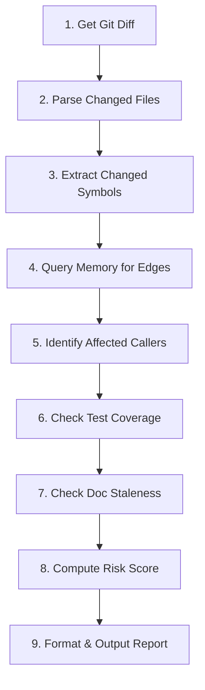

# 15. `kaioken review` — Diff Analyzer & Breaking Change Detector

> **Status**: 🟢 Implemented (Phase 20)
> **CLI Entry**: `kaioken review`
> **Source Modules**: `src/cli/review.rs`, `src/review/mod.rs`, `src/review/diff.rs`, `src/review/impact.rs`, `src/review/scoring.rs`
> **Tests**: `tests/phase20_review_tests.rs` (8 unit & integration tests)

---

## 1. Purpose & Motivation

`kaioken review` is a **pre-commit / pre-push intelligence layer** that compares Git changes (staged or unstaged) against the agent's structured memory to proactively identify:

1. **Breaking changes**: Modified function signatures, removed public symbols, altered struct fields
2. **Affected callers**: Files/symbols that depend on changed code (via the `edges` table)
3. **Test gaps**: Changed code that lacks corresponding test coverage
4. **Documentation staleness**: Modified files whose `.agent-docs/` mirrors will become stale
5. **Risk assessment**: Quantified change risk based on blast radius and complexity

This gives developers **pre-commit confidence** — similar to a lightweight code review by the agent.

---

## 2. CLI Interface

```text
kaioken review
├── (default)          # Review unstaged + staged changes
├── --staged           # Review only staged changes
├── --commit <hash>    # Review a specific past commit
├── --against <branch> # Diff against a branch (e.g., main)
├── --severity <min>   # Filter: only show findings ≥ severity (info, warn, breaking)
├── --json             # Output as structured JSON
└── --fix              # Auto-generate fix suggestions (requires LLM)
```

### 2.1 CLI Args

```rust
#[derive(clap::Args)]
pub struct ReviewArgs {
    /// Review only staged changes
    #[arg(long)]
    pub staged: bool,
    /// Review a specific commit
    #[arg(long)]
    pub commit: Option<String>,
    /// Diff against a specific branch
    #[arg(long)]
    pub against: Option<String>,
    /// Minimum severity to display
    #[arg(long, default_value = "info")]
    pub severity: String,
    /// Output as JSON
    #[arg(long)]
    pub json: bool,
    /// Generate LLM-powered fix suggestions
    #[arg(long)]
    pub fix: bool,
}
```

---

## 3. Analysis Pipeline



### Step-by-Step Detail

| Step | Input | Output | Method |
|------|-------|--------|--------|
| **1. Get Git Diff** | CLI flags | Raw diff output | `git diff` / `git diff --staged` / `git diff <branch>` |
| **2. Parse Changed Files** | Raw diff | `Vec<ChangedFile>` with hunks | Parse unified diff format |
| **3. Extract Changed Symbols** | Changed files + line ranges | `Vec<AffectedSymbol>` | Cross-reference `symbols` table line ranges with diff hunks |
| **4. Query Memory for Edges** | Affected symbols | `Vec<EdgeRecord>` | Query `edges` where `source_symbol_id` or `target_symbol_id` matches |
| **5. Identify Affected Callers** | Edges | `Vec<AffectedCaller>` | Reverse-traverse edges to find all callers/importers |
| **6. Check Test Coverage** | Affected symbols + file paths | `Vec<TestGap>` | Check if test files exist for changed modules |
| **7. Check Doc Staleness** | Changed file paths | `Vec<StaleDoc>` | Query `docs` table for matching paths |
| **8. Compute Risk Score** | All findings | `RiskAssessment` | Weighted formula (see §4) |
| **9. Format & Output** | Complete report | Terminal/JSON | Render human-readable or structured output |

---

## 4. Risk Scoring Algorithm

```rust
pub struct RiskAssessment {
    pub score: f64,        // 0.0 (safe) to 1.0 (critical)
    pub level: RiskLevel,  // Low, Medium, High, Critical
    pub factors: Vec<RiskFactor>,
}

pub enum RiskFactor {
    PublicApiChange { symbol: String, weight: f64 },
    HighFanOutSymbol { symbol: String, callers: usize, weight: f64 },
    NoTestCoverage { file: String, weight: f64 },
    StaleDocumentation { doc_path: String, weight: f64 },
    LargeChangeSet { files_changed: usize, weight: f64 },
    PreviousFailure { error_sig: String, weight: f64 },
}
```

**Scoring Weights:**

| Factor | Weight | Condition |
|--------|--------|-----------|
| Public API change | +0.25 | Modified `pub` function/struct signature |
| High fan-out (>5 callers) | +0.20 | Symbol has >5 incoming edges |
| No test coverage | +0.15 | Changed file has no corresponding test |
| Previous failure in file | +0.15 | File appears in unresolved `failures` |
| Stale documentation | +0.10 | Changed file's doc is now stale |
| Large change set (>10 files) | +0.10 | Diff touches >10 files |
| Breaking signature change | +0.30 | Function params/return type changed |

**Risk Levels:**
- `score < 0.25` → **Low** (green)
- `0.25 ≤ score < 0.50` → **Medium** (yellow)
- `0.50 ≤ score < 0.75` → **High** (orange)
- `score ≥ 0.75` → **Critical** (red)

---

## 5. Output Format

### 5.1 Terminal Output

```text
🔍 kaioken review — Change Analysis Report
═══════════════════════════════════════════════════════════════

  📁 Changed Files: 3
  ├── src/scanner/tree_sitter.rs    (+15, -3)
  ├── src/scanner/languages.rs      (+5, -0)
  └── src/memory/mod.rs             (+2, -1)

  ⚠️  Breaking Changes (1)
  ─────────────────────────
  • src/scanner/tree_sitter.rs:L72
    fn extract_symbols(path: &Path) → fn extract_symbols(path: &Path, lang: Language)
    Signature changed: added parameter `lang: Language`
    Affected callers (3):
      → src/memory/mod.rs:L145 (sync_inventory)
      → src/cli/memory.rs:L89 (handle_scan)
      → tests/scanner_tests.rs:L23 (test_extract_rust)

  🧪 Test Gaps (1)
  ─────────────────
  • src/scanner/languages.rs — No test file found
    Suggestion: Create tests/scanner_languages_test.rs

  📝 Documentation Impact (2)
  ────────────────────────────
  • .agent-docs/src/scanner/tree_sitter.md → will become STALE
  • .agent-docs/src/scanner/languages.md → will become STALE

  📊 Risk Assessment
  ──────────────────
  Score: 0.55 / 1.00  [HIGH ⚠️]
  Factors:
    +0.25  Public API change (extract_symbols signature)
    +0.20  High fan-out symbol (3 callers affected)
    +0.10  Stale documentation (2 docs)

═══════════════════════════════════════════════════════════════
  💡 Recommendation: Update callers before committing.
     Run `kaioken docs generate --stale` after commit.
```

---

## 6. Architecture & Integration Points

### 6.1 Module Layout

```text
src/
├── cli/
│   ├── mod.rs       ← Add `Review(ReviewArgs)` variant to Commands enum
│   └── review.rs    ← NEW: CLI handler
├── review/
│   ├── mod.rs       ← NEW: ReviewEngine orchestrator
│   ├── diff.rs      ← NEW: Git diff parser & symbol matcher
│   ├── impact.rs    ← NEW: Blast radius calculator
│   └── scoring.rs   ← NEW: Risk scoring algorithm
├── scanner/
│   └── git.rs       ← REUSE: get_changed_files(), get_diff()
├── memory/
│   └── mod.rs       ← REUSE: query symbols, edges, failures
```

### 6.2 Core Interface

```rust
pub struct ReviewEngine;

impl ReviewEngine {
    pub fn review(
        repo_root: &Path,
        memory: &MemoryEngine,
        args: &ReviewArgs,
    ) -> Result<ReviewReport> {
        let diff = Self::get_diff(repo_root, args)?;
        let changed_files = Self::parse_changed_files(&diff)?;
        let affected_symbols = Self::match_symbols_to_hunks(&changed_files, memory)?;
        let affected_callers = Self::find_affected_callers(&affected_symbols, memory)?;
        let test_gaps = Self::check_test_coverage(&changed_files, memory)?;
        let stale_docs = Self::check_doc_staleness(&changed_files, memory)?;
        let risk = Self::compute_risk(&affected_symbols, &affected_callers, &test_gaps, &stale_docs)?;

        Ok(ReviewReport {
            changed_files,
            breaking_changes: Self::detect_breaking(&affected_symbols)?,
            affected_callers,
            test_gaps,
            stale_docs,
            risk,
        })
    }
}
```

### 6.3 Dependencies

- **Existing**: `scanner::git`, `MemoryEngine`, `chrono`, `regex`
- **No new crate dependencies**

---

## 7. Testing Strategy

| Test | Description |
|------|-------------|
| `test_review_no_changes` | Clean working tree → "No changes to review" |
| `test_review_simple_edit` | Non-breaking edit → Low risk |
| `test_review_signature_change` | Modified pub fn signature → Breaking change detected |
| `test_review_affected_callers` | Symbol with 3 edges → 3 callers listed |
| `test_review_test_gap` | Changed file with no test → Test gap flagged |
| `test_review_risk_scoring` | Multiple factors → correct weighted score |
| `test_review_json_output` | Verify JSON schema |
| `test_review_staged_only` | Only staged files analyzed |

---

## 8. Open Questions

- [ ] Should `review` integrate with GitHub PR comments (post findings as review comments)?
- [ ] Should `--fix` generate actual code patches (e.g., update caller signatures)?
- [ ] Should `review` support **custom rules** (e.g., "any change to `pub fn` requires test update")?
