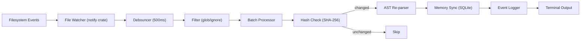

# 16. `kaioken watch` — Real-Time File Watcher Daemon

> **Status**: 🟢 Implemented (Phase 21)
> **CLI Entry**: `kaioken watch`
> **Source Modules**: `src/cli/watch.rs`, `src/watcher/mod.rs`, `src/watcher/debounce.rs`, `src/watcher/filter.rs`, `src/watcher/sync.rs`

---

## 1. Purpose & Motivation

`kaioken watch` is a **long-running daemon** that monitors the workspace for file changes in real-time and automatically triggers debounced AST re-parsing and memory synchronization. Instead of relying solely on `git commit` hooks or manual `kaioken memory scan` commands, `watch` keeps the agent's structured memory **continuously up-to-date** as the developer edits code.

Key benefits:
- **Zero-friction memory sync**: No manual commands needed during active development
- **Sub-second awareness**: The agent knows about code changes within ~500ms of the save
- **IDE integration ready**: Foundation for real-time language-server-like features

---

## 2. CLI Interface

```text
kaioken watch
├── (default)              # Start the file watcher daemon
├── --debounce <ms>        # Debounce interval in milliseconds (default: 500)
├── --include <patterns>   # Glob patterns to watch (default: language files)
├── --exclude <patterns>   # Glob patterns to ignore
├── --no-ast               # Skip AST re-parsing, only update file hashes
├── --daemon               # Run as a background daemon (detach from terminal)
├── --pid-file <path>      # Write PID file for daemon management
├── --verbose              # Log every detected change
├── --ipc-port <port>      # Desktop/TUI IPC port (default: 47890)
└── --no-ipc               # Do not start the local IPC server
```

### 2.1 CLI Args

```rust
#[derive(clap::Args)]
pub struct WatchArgs {
    /// Debounce interval in milliseconds
    #[arg(long, default_value = "500")]
    pub debounce: u64,
    /// Glob patterns to include (comma-separated)
    #[arg(long)]
    pub include: Option<String>,
    /// Glob patterns to exclude (comma-separated)
    #[arg(long)]
    pub exclude: Option<String>,
    /// Skip AST re-parsing, only track file changes
    #[arg(long)]
    pub no_ast: bool,
    /// Run as a background daemon
    #[arg(long)]
    pub daemon: bool,
    /// PID file path for daemon management
    #[arg(long)]
    pub pid_file: Option<String>,
    /// Log every file change event
    #[arg(long)]
    pub verbose: bool,
    /// TCP port for the local desktop/TUI IPC server
    #[arg(long, default_value_t = 47890)]
    pub ipc_port: u16,
    /// Do not start the local IPC server
    #[arg(long)]
    pub no_ipc: bool,
}
```

---

## 3. Architecture & Design

### 3.1 High-Level Architecture



### 3.2 Module Layout

```text
src/
├── cli/
│   ├── mod.rs       ← Add `Watch(WatchArgs)` variant to Commands enum
│   └── watch.rs     ← CLI handler, daemon management, IPC startup
├── desktop/
│   ├── daemon.rs    ← Shared DaemonService request handler
│   └── ipc.rs       ← TCP server/client, event broadcast
├── watcher/
│   ├── mod.rs       ← WatchEngine orchestrator + `event_sink`
│   ├── debounce.rs  ← Event debouncing & batching
│   ├── filter.rs    ← Glob pattern matching
│   └── sync.rs      ← Incremental memory synchronization
├── scanner/
│   ├── file_inventory.rs  ← REUSE: hash calculation, parse_status
│   └── tree_sitter.rs     ← REUSE: AST symbol extraction
├── memory/
│   └── mod.rs              ← REUSE: upsert_file, upsert_symbols
```

### 3.3 Event Processing Pipeline

```rust
pub struct WatchEngine {
    repo_root: PathBuf,
    memory: MemoryEngine,
    debounce_ms: u64,
    include_patterns: Vec<glob::Pattern>,
    exclude_patterns: Vec<glob::Pattern>,
    skip_ast: bool,
}

impl WatchEngine {
    pub async fn run(&self) -> Result<()> {
        let (tx, rx) = std::sync::mpsc::channel();
        
        // Create file watcher with debounced events
        let mut watcher = notify::recommended_watcher(tx)?;
        watcher.watch(&self.repo_root, RecursiveMode::Recursive)?;

        println!("👁️  Watching {} for changes...", self.repo_root.display());
        
        let mut pending: HashMap<PathBuf, Instant> = HashMap::new();
        
        loop {
            // Collect events, batch by debounce window
            match rx.recv_timeout(Duration::from_millis(100)) {
                Ok(event) => {
                    for path in event.paths {
                        if self.should_process(&path) {
                            pending.insert(path, Instant::now());
                        }
                    }
                }
                Err(RecvTimeoutError::Timeout) => {}
                Err(RecvTimeoutError::Disconnected) => break,
            }
            
            // Process debounced events
            let now = Instant::now();
            let debounce = Duration::from_millis(self.debounce_ms);
            let ready: Vec<PathBuf> = pending
                .iter()
                .filter(|(_, t)| now.duration_since(**t) >= debounce)
                .map(|(p, _)| p.clone())
                .collect();
            
            for path in ready {
                pending.remove(&path);
                self.process_change(&path).await?;
            }
        }
        
        Ok(())
    }
    
    async fn process_change(&self, path: &Path) -> Result<()> {
        // 1. Compute new hash
        // 2. Compare with stored hash in SQLite
        // 3. If changed: re-extract AST symbols (unless --no-ast)
        // 4. Upsert file + symbols to memory
        // 5. Log event
    }
}
```

### 3.4 IPC Server & Event Stream

`kaioken watch` also serves the desktop and TUI clients. The server is not a second
process and does not own the watcher: it shares the daemon process and the same SQLite
database file (WAL mode permits one writer and concurrent readers).

```text
watch process
├── WatchEngine ── writes files/symbols ──► .agent/memory.sqlite (WAL)
│        │
│        └── event_sink: broadcast<IpcEvent>
│                 ├── FileChanged { path, change_type }
│                 └── MemoryUpdated { total_files, total_symbols, total_edges }
│
└── DaemonIpcServer (127.0.0.1:<--ipc-port>)
         ├── request loop → DaemonService (its own SQLite connection)
         └── event loop   → every connected client
```

- **Transport**: line-delimited JSON `WireMessage` envelopes over loopback TCP.
- **Port**: `--ipc-port`, default `47890`; `0` binds an ephemeral port and prints it.
- **Startup failure**: the watcher logs a warning and keeps synchronizing; IPC is optional.
- **Heartbeat**: a `Heartbeat` event is broadcast every 15 seconds so clients can detect a
  dead connection even when no files change.
- **Slow clients**: a lagged subscriber misses intermediate events (`RecvError::Lagged`)
  and continues from the newest event; the daemon never blocks on a slow reader.
- **Read-only queries**: `GetMemoryStats`, `GetMemoryGraph`, `GetReviewDiff`,
  `GetAuditLogs`, `GetDocsHealth`, `GetStatus`, `Ping`.
- **Agent mutations**: `StartAgentTask`, approvals, cancellation, and docs regeneration
  return error `-32601`; the watcher intentionally does not host an agent loop.

---

## 4. Debouncing Strategy

### Why Debounce?

IDEs often trigger multiple filesystem events for a single save (e.g., write temp file → rename → delete backup). Without debouncing, the watcher would wastefully re-parse the same file multiple times.

### Debounce Rules

| Rule | Behavior |
|------|----------|
| **Window** | 500ms (configurable via `--debounce`) |
| **Batching** | Multiple events for the same path within the window → single processing |
| **Hash check** | Even after debounce, skip processing if SHA-256 hash hasn't changed |
| **Burst protection** | If >50 files change simultaneously (e.g., `git checkout`), batch all and process sequentially |

---

## 5. Terminal Output

### 5.1 Normal Mode

```text
👁️  Watching d:/project/ai_now_know/kaioRust for changes...
   Press Ctrl+C to stop

  [09:15:02] ✏️  src/scanner/tree_sitter.rs (3 symbols updated)
  [09:15:15] ✏️  src/cli/memory.rs (1 symbol updated)
  [09:16:30] ➕  src/review/mod.rs (new file, 5 symbols extracted)
  [09:17:00] 🗑️  src/old_module.rs (removed from memory)
```

### 5.2 Verbose Mode (`--verbose`)

```text
👁️  Watching d:/project/ai_now_know/kaioRust for changes...

  [09:15:02.123] EVENT   Modify  src/scanner/tree_sitter.rs
  [09:15:02.234] EVENT   Modify  src/scanner/tree_sitter.rs  (debounce merge)
  [09:15:02.625] HASH    Changed  a1b2c3→d4e5f6  src/scanner/tree_sitter.rs
  [09:15:02.650] AST     Extracted 10 symbols (3 changed)
  [09:15:02.680] MEMORY  Upserted file + 3 symbols to SQLite
  [09:15:02.685] DONE    src/scanner/tree_sitter.rs (60ms)
```

---

## 6. Daemon Mode

When `--daemon` is specified:

1. Fork the process (Unix) or spawn a detached child process (Windows)
2. Write PID to `--pid-file` (default: `.agent/watch.pid`)
3. Redirect stdout/stderr to `.agent/logs/watch.log`
4. Return immediately with PID printed

### Daemon Management

```text
# Start daemon
$ kaioken watch --daemon
👁️  Watcher daemon started (PID: 12345)
   Log: .agent/logs/watch.log

# Stop daemon
$ kill $(cat .agent/watch.pid)
   # or on Windows:
$ taskkill /PID 12345
```

---

## 7. Default Include/Exclude Patterns

### Default Includes (based on `Language::is_ast_supported()`)

```text
**/*.rs, **/*.ts, **/*.tsx, **/*.js, **/*.jsx, **/*.py
```

### Default Excludes (mirrors `scanner.ignore` config)

```text
**/node_modules/**, **/target/**, **/dist/**, **/build/**,
**/.git/**, **/.agent/**, **/.agent-docs/**
```

---

## 8. New Crate Dependency

```toml
# In Cargo.toml
[dependencies]
notify = { version = "6.1", features = ["macos_kqueue"] }
```

The `notify` crate provides cross-platform filesystem event watching:
- **Linux**: `inotify`
- **macOS**: `kqueue` or `FSEvents`
- **Windows**: `ReadDirectoryChangesW`

---

## 9. Concurrency & Safety

| Concern | Solution |
|---------|----------|
| **Lockfile contention** | Watcher acquires `.agent/scan.lock` briefly per batch, same as `memory scan` |
| **SQLite WAL conflicts** | WAL mode supports concurrent readers; watcher is the only writer during watch |
| **Graceful shutdown** | SIGINT/SIGTERM handler flushes pending events before exit |
| **Crash recovery** | Stale PID file detection; watcher checks if PID is still alive on start |

---

## 10. Testing Strategy

| Test | Description |
|------|-------------|
| `test_watch_detects_change` | Create file → modify → verify memory updated |
| `test_watch_debounce` | Rapid edits → single processing event |
| `test_watch_hash_skip` | Touch file without changing content → no re-parse |
| `test_watch_new_file` | Create new `.rs` file → symbols extracted |
| `test_watch_delete_file` | Delete file → removed from memory |
| `test_watch_exclude_patterns` | Edit file in `target/` → not processed |
| `test_watch_burst_protection` | 100 files change at once → batched processing |

---

## 11. Open Questions

- [ ] Should `watch` also trigger **doc staleness cascade** on file changes?
- [ ] Should `watch` support a **WebSocket API** for IDE plugins to subscribe to memory updates?
- [ ] Should there be a `kaioken watch status` command to check if the daemon is running?
- [ ] Should `watch` integrate with `kaioken review` to auto-run reviews on save?
