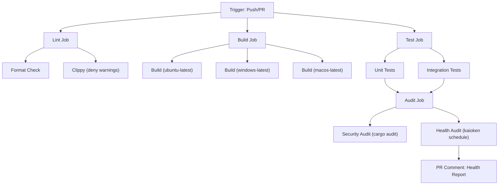

# 18. GitHub Actions CI/CD Pipeline

> **Status**: 🟢 Implemented (Phase 23)
> **Target Files**: `.github/workflows/ci.yml`, `.github/workflows/maintenance.yml`
> **Affected Files**: `Cargo.toml` (profiles & lints), `README.md` (badges)

---

## 1. Purpose & Motivation

A **GitHub Actions CI/CD pipeline** automates quality gates on every push and pull request:

1. **Build verification**: Ensure `cargo build` succeeds across platforms
2. **Test execution**: Run the full 93+ test suite (`cargo test`)
3. **Lint enforcement**: `cargo clippy` with deny warnings
4. **Format checking**: `cargo fmt -- --check`
5. **Health audit**: Run `kaioken schedule --daily` to generate a health report
6. **Benchmark tracking**: Optional performance benchmarking on PRs
7. **Security scanning**: `cargo audit` for known vulnerabilities

This pipeline prevents regressions, enforces code quality, and provides continuous feedback.

---

## 2. Pipeline Architecture

### 2.1 Trigger Strategy

```yaml
on:
  push:
    branches: [main, develop]
  pull_request:
    branches: [main, develop]
  schedule:
    - cron: '0 6 * * 1'  # Weekly Monday 6 AM UTC — full audit
```

### 2.2 Job Matrix



---

## 3. Complete Pipeline Specification

### 3.1 Workflow File: `.github/workflows/ci.yml`

```yaml
name: CI

on:
  push:
    branches: [main, develop]
  pull_request:
    branches: [main, develop]

env:
  CARGO_TERM_COLOR: always
  RUST_BACKTRACE: 1

jobs:
  # ─────────────────────────────────────────
  # Job 1: Code Quality (Lint + Format)
  # ─────────────────────────────────────────
  lint:
    name: Lint & Format
    runs-on: ubuntu-latest
    steps:
      - uses: actions/checkout@v4
      - uses: dtolnay/rust-toolchain@stable
        with:
          components: clippy, rustfmt
      - uses: Swatinem/rust-cache@v2
      - name: Check formatting
        run: cargo fmt -- --check
      - name: Run clippy
        run: cargo clippy --all-targets --all-features -- -D warnings

  # ─────────────────────────────────────────
  # Job 2: Build (Cross-Platform)
  # ─────────────────────────────────────────
  build:
    name: Build (${{ matrix.os }})
    runs-on: ${{ matrix.os }}
    strategy:
      fail-fast: false
      matrix:
        os: [ubuntu-latest, windows-latest, macos-latest]
    steps:
      - uses: actions/checkout@v4
      - uses: dtolnay/rust-toolchain@stable
      - uses: Swatinem/rust-cache@v2
        with:
          key: ${{ matrix.os }}
      - name: Build
        run: cargo build --verbose
      - name: Build (release)
        run: cargo build --release
        if: github.ref == 'refs/heads/main'

  # ─────────────────────────────────────────
  # Job 3: Tests
  # ─────────────────────────────────────────
  test:
    name: Tests (${{ matrix.os }})
    runs-on: ${{ matrix.os }}
    needs: [lint]
    strategy:
      fail-fast: false
      matrix:
        os: [ubuntu-latest, windows-latest]
    steps:
      - uses: actions/checkout@v4
      - uses: dtolnay/rust-toolchain@stable
      - uses: Swatinem/rust-cache@v2
        with:
          key: ${{ matrix.os }}-test
      - name: Run tests
        run: cargo test --verbose -- --nocapture
      - name: Run tests (release mode)
        run: cargo test --release
        if: matrix.os == 'ubuntu-latest'

  # ─────────────────────────────────────────
  # Job 4: Security Audit
  # ─────────────────────────────────────────
  security:
    name: Security Audit
    runs-on: ubuntu-latest
    steps:
      - uses: actions/checkout@v4
      - uses: rustsec/audit-check@v2
        with:
          token: ${{ secrets.GITHUB_TOKEN }}

  # ─────────────────────────────────────────
  # Job 5: Health Audit (on main only)
  # ─────────────────────────────────────────
  health:
    name: Health Audit
    runs-on: ubuntu-latest
    needs: [test]
    if: github.ref == 'refs/heads/main'
    steps:
      - uses: actions/checkout@v4
        with:
          fetch-depth: 0  # Full history for commit memory
      - uses: dtolnay/rust-toolchain@stable
      - uses: Swatinem/rust-cache@v2
      - name: Build kaioken
        run: cargo build --release
      - name: Initialize memory
        run: ./target/release/kaioken memory init
      - name: Run full scan
        run: ./target/release/kaioken memory scan --no-llm
      - name: Generate health report
        run: ./target/release/kaioken schedule --daily --json > health-report.json
      - name: Upload health report
        uses: actions/upload-artifact@v4
        with:
          name: health-report
          path: health-report.json
```

---

## 4. Caching Strategy

| Cache Layer | Tool | Key | Purpose |
|-------------|------|-----|---------|
| **Cargo registry** | `Swatinem/rust-cache` | `${{ matrix.os }}` | Cache downloaded crate registry |
| **Cargo build** | `Swatinem/rust-cache` | `${{ matrix.os }}-test` | Cache compiled dependencies |
| **SQLite DB** | None (rebuilt per run) | — | Memory DB is lightweight; fresh is better |

Expected cache hit savings: **~3-5 minutes** per job.

---

## 5. PR Status Checks

Configure the following as **required status checks** for PRs:

| Check | Job | Required |
|-------|-----|----------|
| Formatting | `lint` | ✅ Yes |
| Clippy | `lint` | ✅ Yes |
| Build (ubuntu) | `build` | ✅ Yes |
| Build (windows) | `build` | ✅ Yes |
| Tests (ubuntu) | `test` | ✅ Yes |
| Tests (windows) | `test` | ✅ Yes |
| Security audit | `security` | ⚠️ Advisory |
| Health audit | `health` | ❌ No (main only) |

---

## 6. Badge Configuration

Add to `README.md`:

```markdown
[](https://github.com/<owner>/kaioken/actions/workflows/ci.yml)
[](https://github.com/<owner>/kaioken/actions/workflows/ci.yml)
```

---

## 7. Weekly Maintenance Job

```yaml
# .github/workflows/maintenance.yml
name: Weekly Maintenance

on:
  schedule:
    - cron: '0 6 * * 1'  # Monday 6 AM UTC

jobs:
  maintenance:
    name: Weekly Scan & Audit
    runs-on: ubuntu-latest
    steps:
      - uses: actions/checkout@v4
        with:
          fetch-depth: 0
      - uses: dtolnay/rust-toolchain@stable
      - uses: Swatinem/rust-cache@v2
      - name: Build
        run: cargo build --release
      - name: Full repository scan
        run: ./target/release/kaioken memory init && ./target/release/kaioken memory scan --no-llm
      - name: Health audit
        run: ./target/release/kaioken schedule --daily --json > weekly-report.json
      - name: Security audit
        run: cargo install cargo-audit && cargo audit
      - name: Upload report
        uses: actions/upload-artifact@v4
        with:
          name: weekly-report-${{ github.run_number }}
          path: weekly-report.json
          retention-days: 90
```

---

## 8. Environment & Secrets

| Secret/Variable | Purpose | Required |
|------------------|---------|----------|
| `GITHUB_TOKEN` | Automatic — PR comments, artifact upload | ✅ Auto |
| `OPENROUTER_API_KEY` | Only for LLM-powered features (not in CI) | ❌ Not needed |
| `CARGO_REGISTRY_TOKEN` | Only for publishing releases | ❌ Optional |

---

## 9. Performance Targets

| Metric | Target | Current Estimate |
|--------|--------|------------------|
| Lint job duration | < 2 min | ~1 min (cached) |
| Build job (ubuntu) | < 5 min | ~3 min (cached) |
| Build job (windows) | < 8 min | ~5 min (cached) |
| Test job | < 5 min | ~2 min (93 tests) |
| Full pipeline (PR) | < 10 min | ~7 min (parallel) |
| Health audit | < 3 min | ~2 min |

---

## 10. Open Questions

- [ ] Should we add **code coverage** reporting (e.g., `tarpaulin` or `llvm-cov`)?
- [ ] Should PRs get an **auto-generated health diff** comment comparing before/after health scores?
- [ ] Should we add a **release workflow** that publishes binaries to GitHub Releases?
- [ ] Should benchmark results be tracked over time with a **performance dashboard**?
