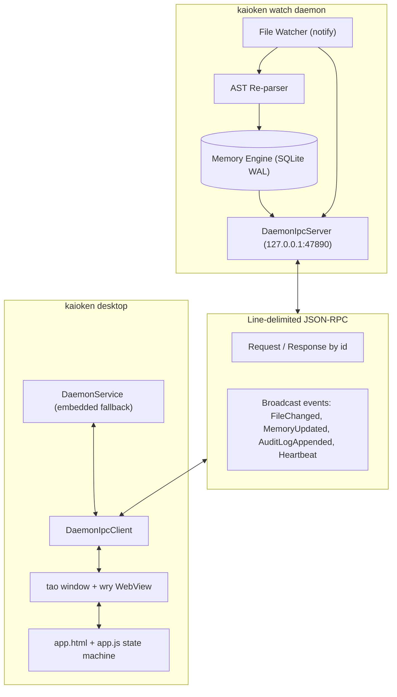

# 19. Native Desktop Cockpit (`wry` + `tao`)

> **Status**: 🟢 Implemented (Phase 24)
> **Priority**: **P3 — Primary Visual Interface** (Foundation: [16_watch_daemon.md](16_watch_daemon.md))
> **Framework**: **`wry` 0.42** (system WebView) + **`tao` 0.28** (windowing)
> **Source Modules**: `src/desktop/` (`app.rs`, `daemon.rs`, `embedded.rs`, `ipc.rs`, `gui.rs`, `view.rs`, `model.rs`, `ui/`)
> **Tests**: `tests/phase24_desktop_tests.rs`, `tests/daemon_ipc_tests.rs`

---

## 1. Purpose & Motivation

The Kaioken desktop application is the primary graphical interface for the agent. It is a
**native Rust host** that renders its cockpit with the operating system's WebView, not with
Electron: no bundled Chromium, no Node.js runtime, and no second copy of the JavaScript
ecosystem.

### Why `wry` + `tao` instead of a GPU UI toolkit?

1. **Small, native host**:
   - `tao` owns the window and event loop; `wry` embeds the system WebView
     (WebView2 on Windows, WKWebView on macOS, WebKitGTK on Linux).
   - The Rust process keeps memory, IPC, and the agent runtime; only the presentation
     layer is HTML/CSS/JS.
2. **No frontend build step**:
   - `ui/app.html`, `ui/design.css`, and `ui/app.js` are embedded with `include_str!`
     and served from a single custom `wry://` document. There is no bundler, package
     manager, or dev server to keep alive.
3. **One state model**:
   - Rust remains the source of truth (`KaiokenAppWindow::snapshot_json()`). The WebView
     receives snapshots and merges them by revision instead of rebuilding the page.
4. **Cross-platform window chrome**:
   - The window is undecorated and implements resize hit-testing, drag, minimize,
     maximize, and double-click maximize through `tao` events.

The earlier blueprint proposed `gpui` (Zed's GPU toolkit). It was not adopted because the
cockpit is form-heavy and benefits from HTML layout, while `gpui` still requires a
bleeding-edge toolchain and does not solve the daemon/IPC problem. The directory and this
document keep the historical `gpui` name; the shipped implementation is `wry` + `tao`.

---

## 2. Architectural Blueprint: Daemon-First Model

The desktop is a **thin client** over the same JSON-RPC protocol used by the TUI.



### 2.1 IPC Communication Modes

1. **Daemon mode (default)**:
   - Connects to `127.0.0.1:47890` (override with `--endpoint`).
   - Connection is attempted with a 1.5 s timeout. When no daemon answers, the CLI prints
     an actionable warning and starts the embedded runtime; it does not silently use a mock.
   - `kaioken watch` serves requests and broadcasts `FileChanged` / `MemoryUpdated` events.
2. **Embedded mode (`--embedded`)**:
   - Hosts memory and the request dispatcher in the desktop process. The watcher is not
     spawned by default.

### 2.2 Shared Request Handler

`src/desktop/daemon.rs` defines `DaemonService`, used by both the daemon and the embedded
runtime. This is deliberate: a mock-only desktop previously diverged from the real daemon.
Supported requests:

| Request | Response |
|---|---|
| `Ping` | mode, endpoint |
| `GetStatus` | pid, uptime, version, repo root, mode, endpoint |
| `GetMemoryStats` | files, symbols, edges, docs, commits, failures |
| `GetMemoryGraph` | filtered file nodes |
| `GetReviewDiff` | unified diff, risk score/level, changed files, callers, test gaps |
| `GetAuditLogs` | recent audit entries |
| `GetDocsHealth` | total/fresh/stale/maybe-stale docs |

Agent-hosting requests (`StartAgentTask`, `ApproveToolCall`, `DenyToolCall`, `CancelTask`,
`RegenerateDocs`) return JSON-RPC error `-32601`, because the watcher daemon does not host
an agent loop. The desktop therefore never reports a tool as executed when no executor
exists.

### 2.3 Endpoint Policy

Loopback TCP is used on every platform. Named pipes and Unix domain sockets are not
implemented; `default_ipc_endpoint()` used to return them anyway, so the desktop tried an
address no server bound. TCP also works across the WSL2 boundary. The server binds
`127.0.0.1` only. There is no authentication token yet; this is a local-only protocol and
should not be exposed on a public interface.

---

## 3. Desktop Application Views

The cockpit exposes eleven routes from `app.js` (`ROUTE_META`):

| Route | Purpose |
|---|---|
| `chat` | Agent task runner, streamed thoughts, approval cards |
| `research` | Power level, source gathering, cited dossier |
| `wiki` | Generated chapters, tree navigation, reader, TOC |
| `graph` | AST symbol topology and caller/dependency inspector |
| `cards` | Failure cards and knowledge cards |
| `editor` | Code/diff viewer, file tabs, terminal rail |
| `browser` | In-app request inspector with tabs |
| `activity` | Runs, watcher events, learned skills |
| `extensions` | Installed/registry extensions, trust gate |
| `cost` | Token and USD ledger, by operation/model/provider/day |
| `settings` | Permission mode, model, daemon mode, keys, theme |

Window chrome is borderless and handled by `gui.rs`:

- drag region in the titlebar,
- 5 px resize inset with direction-specific cursors,
- minimize / maximize / close IPC actions,
- double-click titlebar to maximize or restore.

---

## 4. Component & State Architecture

### 4.1 State Flow

1. `handle_desktop_command` builds a `KaiokenDesktopController` with the chosen IPC client.
2. `initial_sync()` fetches memory stats and docs health.
3. `build_html()` inlines CSS, JS, and the initial snapshot into one document.
4. The `tao` loop polls `controller.revision` every 200 ms. When it advances, the new
   snapshot is pushed with `window.KAI.mergeState(json)`.
5. UI actions call `window.ipc.postMessage(JSON.stringify(message))`; `handle_ipc()`
   dispatches them to the controller or window event loop.

`mergeState()` deep-merges the snapshot, preserves local UI state (selection, draft
settings, toasts), and re-renders. The WebView is never reloaded on a state push.

### 4.2 Source Layout

```text
src/desktop/
├── app.rs        # controller: chat, research, approvals, settings actions
├── daemon.rs     # shared DaemonService request handler
├── embedded.rs   # in-process runtime + mock IPC transport
├── gui.rs        # tao window, wry WebView, IPC bridge, custom protocol
├── ipc.rs        # TCP client/server, request timeouts, event broadcast
├── model.rs      # serializable window/session state
├── protocol.rs   # IpcRequest / IpcResponse / IpcEvent / WireMessage
├── theme.rs      # dark/light palettes
├── view.rs       # KaiokenAppWindow, terminal frame renderer
└── ui/
    ├── app.html  # single document with inline assets
    ├── design.css
    └── app.js    # vanilla ES state machine
```

### 4.3 Interactive Approval Flow

Pending proposals are rendered as a modal card with the policy tier:

- `READ_ONLY`: inspective tools, no write side effect.
- `WRITE_PROMPT`: file edits and builds, `Enter` to approve.
- `DANGEROUS`: destructive shell commands, red styling, explicit approval.

Approval actions are sent as `ApproveToolCall` / `DenyToolCall`. Against the watcher daemon
they return an error, which is the correct signal that no agent task is hosted there; the
approval UI belongs to embedded agent sessions, not to the read-only daemon.

---

## 5. Dependencies & Platform Requirements

```toml
wry = "0.42"
tao = "0.28"
```

| Platform | WebView runtime |
|---|---|
| Windows | WebView2 (Edge, present on Windows 10/11) |
| macOS | WKWebView |
| Linux | WebKitGTK (`libwebkit2gtk-4.1`) |

The Rust side has no Node.js dependency. Assets are compiled into the binary.

---

## 6. Testing Strategy

- `tests/phase24_desktop_tests.rs`: window defaults, tab switching, command palette,
  terminal frame, policy tiers, mock event streaming, real TCP request/response,
  approval/denial flows, embedded runtime queries.
- `tests/daemon_ipc_tests.rs`: shared `DaemonService` stats/health/graph responses,
  unsupported mutation errors, event broadcast over TCP, request timeout, watcher event
  publication, and the loopback endpoint default.

Headless verification does not need a display:

```powershell
cargo run -- desktop --embedded --headless
cargo run -- tui --headless
```

`--headless` prints the terminal frame generated by `render_terminal_frame()`.

---

## 7. Known Gaps

- Named pipes / Unix domain sockets are not implemented (TCP loopback only).
- The daemon does not host an agent loop; agent tasks remain in `kaioken task`.
- Live `AgentThought` / `ToolProposed` events exist in the protocol but are not produced by
  the watcher daemon.
- Desktop window size/position are not persisted across launches.
- Memory stats, the symbol graph, review diff/risk, docs health, audit entries, and daemon
  state are loaded from the daemon. Chat history, research, wiki, extensions, and
  cost/token panels still render seeded showcase data until their telemetry backends are
  wired to IPC.
