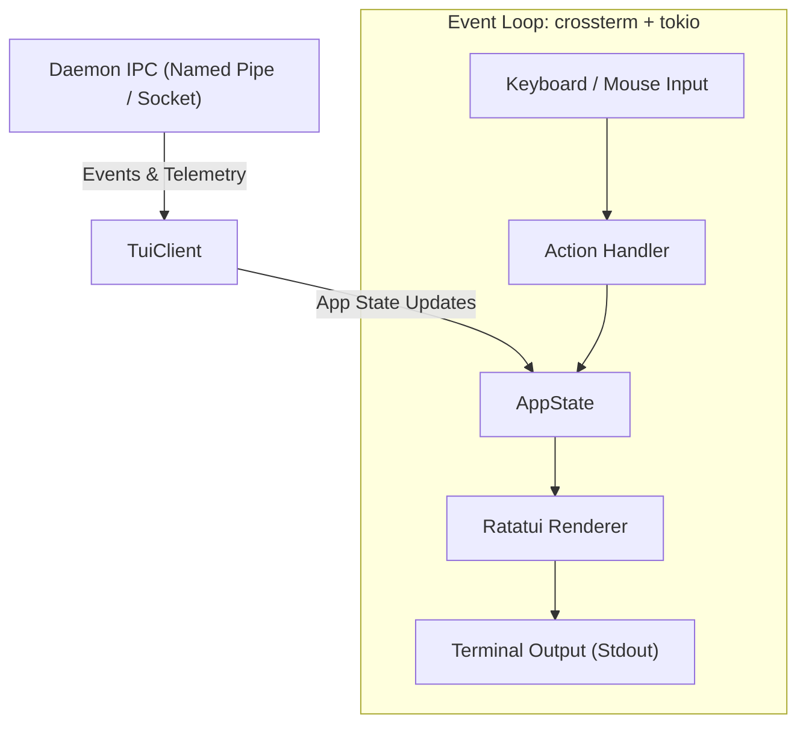

# 20. Interactive Terminal UI (`ratatui`)

> **Status**: 🟢 Implemented (Phase 25)
> **Priority**: **P4 — Interactive Terminal Dashboard**
> **CLI Entry**: `kaioken tui`
> **Source Modules**: `src/cli/tui.rs`, `src/tui/`
> **Tests**: `tests/phase25_tui_tests.rs`

---

## 1. Purpose & Motivation

The Interactive Terminal UI (`kaioken tui`) provides a **keyboard-driven, terminal-native dashboard** for Kaioken. While the primary graphical interface is the **native desktop cockpit ([19_gpui_desktop_app.md](19_gpui_desktop_app.md))**, this TUI remains a lightweight alternative for:
- Remote SSH sessions / cloud devboxes (where no display server / GPU is available)
- Headless CI / containerized debugging
- Terminal purists who prefer staying inside tmux / alacritty / wezterm

The TUI provides real-time visibility into the agent's memory, running tasks, audit events, and codebase health without opening a desktop window.

---

## 2. CLI Interface

```text
kaioken tui
├── (default)              # Launch full interactive TUI
├── --tab <name>           # Initial tab: dashboard, memory, task, review, audit
├── --daemon-url <addr>    # Connect to remote/running daemon (default: local IPC)
├── --poll <ms>            # UI refresh interval in ms (default: 250)
└── --read-only            # Disable interactive execution (inspection only)
```

### 2.1 CLI Args

```rust
#[derive(clap::Args)]
pub struct TuiArgs {
    /// Initial active tab
    #[arg(long, default_value = "dashboard")]
    pub tab: String,

    /// Daemon IPC socket or URL
    #[arg(long)]
    pub daemon_url: Option<String>,

    /// Refresh interval in milliseconds
    #[arg(long, default_value = "250")]
    pub poll: u64,

    /// Run in read-only inspection mode
    #[arg(long)]
    pub read_only: bool,
}
```

---

## 3. Terminal Layout & Views

The TUI uses a classic multi-tab layout powered by `ratatui`:

```text
┌─ Kaioken v0.1.0 ────────────── [Daemon: Connected 🟢] ── [Sync: 500ms ago] ─┐
│ [1] Dashboard  [2] Memory Graph  [3] Task Runner  [4] Review  [5] Audit Log │
├────────────────────────────────┬────────────────────────────────────────────┤
│ Workspace Health               │ Recent Commits & Memory                    │
│ ┌────────────────────────────┐ │ • e8f2a1b - fix(scanner): AST recursion   │
│ │ Score: 94/100 🟢           │ │   Files: 2 | Symbols: +4 -1 | Risk: Low    │
│ │ Doc Coverage: 88%          │ │ • a4b9c10 - feat(memory): WAL mode        │
│ │ Total Files: 42            │ │   Files: 5 | Symbols: +18 -0 | Risk: Med   │
│ │ Total Symbols: 312         │ │                                            │
│ │ Active Locks: None         │ │                                            │
│ └────────────────────────────┘ │                                            │
├────────────────────────────────┴────────────────────────────────────────────┤
│ Live Activity / Agent Output                                                │
│ [12:04:12] [WATCH] Modified src/memory/db.rs -> AST re-parsed (12ms)        │
│ [12:04:15] [CRITIC] cargo check -> Passed (0 errors, 0 warnings)            │
│ [12:04:22] [DOCS] Auto-regenerated .agent-docs/memory/db.md (Level 0)       │
├─────────────────────────────────────────────────────────────────────────────┤
│ [Tab] Switch View  [q] Quit  [r] Refresh  [space] Pause  [?] Help           │
└─────────────────────────────────────────────────────────────────────────────┘
```

### 3.1 Views Breakdown

1. **Dashboard Tab**:
   - High-level overview: health score, memory DB size, AST symbol totals, daemon status.
   - Recent activity stream (file watcher triggers, AST updates, critic checks).
2. **Memory Graph Tab**:
   - Hierarchical tree of modules, structs, traits, and functions.
   - Detail pane displaying Level 0 doc facts, source hash, visibility, and edges.
3. **Task Runner Tab**:
   - Streaming ReAct agent logs when executing `kaioken task`.
   - Tool execution cards (bash commands, file diffs) with approval keybindings (`[y]` approve, `[n]` reject).
4. **Review Tab**:
   - Terminal diff browser showing uncommitted changes.
   - Breaking change warnings and impacted dependent symbols.
5. **Audit Log Tab**:
   - Paginated table of security events from `.agent/logs/audit.log`.
   - Severity badges (🟢 Allowed, 🟡 Redacted, 🔴 Denied).

---

## 4. Architecture & State Management



### 4.1 Module Structure

```text
src/tui/
├── mod.rs              # TUI entry point & run loop
├── app.rs              # App state container & event dispatcher
├── client.rs           # Daemon IPC client
├── events.rs           # Crossterm input event listener
├── ui.rs               # Root frame layout & tab routing
└── views/
    ├── dashboard.rs    # Workspace summary & metrics widget
    ├── memory.rs       # Tree navigator for symbols & files
    ├── task.rs         # Agent output stream & approval prompt
    ├── review.rs       # Terminal diff viewer
    └── audit.rs        # Audit log table widget
```

---

## 5. Dependencies

| Crate | Version | Purpose |
|---|---|---|
| `ratatui` | `0.28` | Terminal UI layout, widgets, and rendering |
| `crossterm` | `0.28` | Terminal raw mode, event polling, ANSI styling |

---

## 6. Strategic Role & Deferred Priority

- **Why Secondary**: For rich graphical capabilities (interactive AST force-directed graphs, side-by-side graphical diffing, multi-turn chat with rich markdown and syntax highlighting), the **desktop cockpit ([19_gpui_desktop_app.md](19_gpui_desktop_app.md))** is the designated tier-1 interface.
- **Implementation Trigger**: Implement this TUI only after the daemon and core CLI tools (P0-P2) are stable, as an optional fallback when desktop GPU rendering is unavailable.
