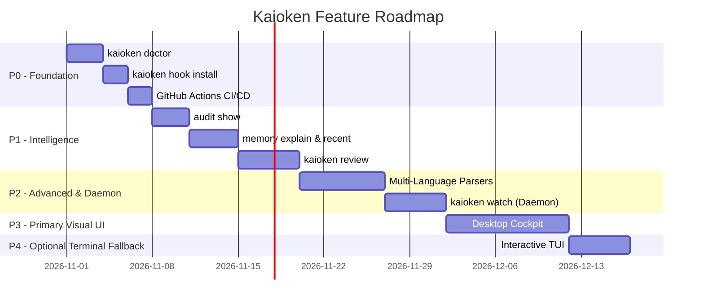
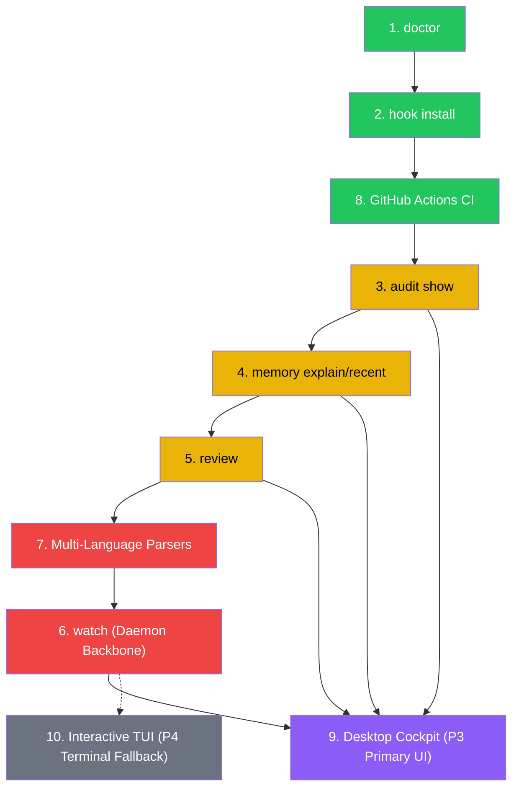

# 21. Future Features — Global Roadmap & Priority Matrix

> **Status**: 🔵 Design Specification Overview
> **Scope**: 10 remaining features beyond Phase 15

---

## 1. Feature Priority Matrix

| # | Feature | Doc | Complexity | Dependencies | Priority | Impact |
|---|---------|-----|-----------|--------------|----------|--------|
| 1 | `kaioken doctor` | [11_doctor_command.md](11_doctor_command.md) | 🟢 Low | None (standalone) | **🟢 Done (Phase 16)** | User onboarding |
| 2 | `kaioken hook install` | [12_hook_install.md](12_hook_install.md) | 🟢 Low | Git available | **🟢 Done (Phase 17)** | Continuous sync |
| 3 | `kaioken audit show` | [13_audit_show.md](13_audit_show.md) | 🟡 Medium | Safety/audit modules | **🟢 Done (Phase 18)** | Trust & compliance |
| 4 | `memory explain` & `recent` | [14_memory_explain_recent.md](14_memory_explain_recent.md) | 🟡 Medium | Memory engine | **🟢 Done (Phase 19)** | Developer trust |
| 5 | `kaioken review` | [15_review_command.md](15_review_command.md) | 🔴 High | Scanner + Memory + Edges | **🟢 Done (Phase 20)** | Pre-commit intelligence |
| 6 | `kaioken watch` (Daemon) | [16_watch_daemon.md](16_watch_daemon.md) | 🔴 High | New crate (`notify`) | **🟢 Done (Phase 21)** | Real-time sync & UI backbone |
| 7 | Multi-Language Parsers | [17_multi_language_parsers.md](17_multi_language_parsers.md) | 🔴 High | New crates (3 grammars) | **🟢 Done (Phase 22)** | Polyglot support |
| 8 | GitHub Actions CI/CD | [18_github_actions_ci.md](18_github_actions_ci.md) | 🟢 Low | None (config only) | **🟢 Done (Phase 23)** | Quality automation |
| 9 | Native Desktop Cockpit | [19_gpui_desktop_app.md](19_gpui_desktop_app.md) | 🔴 High | Daemon (`watch`) + `wry`/`tao` | **🟢 Done (Phase 24)** | Native cockpit & visual agent |
| 10 | Interactive TUI | [20_interactive_tui.md](20_interactive_tui.md) | 🟡 Medium | New crate (`ratatui`) | **🟢 Done (Phase 25)** | Remote/SSH environments |

---

## 2. Recommended Implementation Order



---

## 3. Dependency Graph Between Features



---

## 4. New Crate Dependencies Summary

| Feature | New Crate | Version | Purpose | Size Impact |
|---------|-----------|---------|---------|-------------|
| `watch` (Daemon) | `notify` | 6.1 | Cross-platform FS events | ~500 KB |
| Multi-Language | `tree-sitter-typescript` | 0.23 | TS/TSX grammar | ~2 MB |
| Multi-Language | `tree-sitter-javascript` | 0.23 | JS grammar | ~1.5 MB |
| Multi-Language | `tree-sitter-python` | 0.23 | Python grammar | ~1.5 MB |
| Desktop App (P3) | `wry` | 0.42 | System WebView host (WebView2 / WKWebView / WebKitGTK) | ~1 MB |
| Desktop App (P3) | `tao` | 0.28 | Cross-platform window and event loop | ~500 KB |
| TUI (P4 Fallback)| `ratatui` | 0.28 | Terminal UI framework (optional feature) | ~1.5 MB |
| TUI (P4 Fallback)| `crossterm` | 0.28 | Terminal manipulation (optional feature) | ~500 KB |

---

## 5. CLI Commands After All Features

```text
kaioken
├── doctor              # [NEW] Environment diagnostic runner
├── memory
│   ├── init            # ✅ Exists
│   ├── status          # ✅ Exists
│   ├── scan            # ✅ Exists
│   ├── query           # ✅ Exists
│   ├── explain <path>  # [NEW] File architecture explanation
│   ├── impact          # ✅ Exists
│   └── recent          # [NEW] Recent commit memories
├── retrieval
│   └── context         # ✅ Exists
├── docs
│   ├── generate        # ✅ Exists
│   ├── verify          # ✅ Exists
│   └── cascade         # ✅ Exists
├── task                # ✅ Exists
├── plan                # ✅ Exists
├── review              # [NEW] Diff analyzer & breaking change detector
├── test                # ✅ Exists (critic)
├── build               # ✅ Exists (critic)
├── watch               # [NEW] Real-time file watcher daemon & IPC server
├── schedule            # ✅ Exists
├── audit
│   ├── show            # [NEW] Audit log inspector
│   └── stats           # [NEW] Audit statistics
├── eval
│   └── run             # ✅ Exists
├── hook
│   ├── install         # [NEW] Git hook installer
│   ├── uninstall       # [NEW] Git hook remover
│   └── status          # [NEW] Git hook status check
├── desktop             # [NEW] Launch the native desktop cockpit (tao + wry WebView)
└── tui                 # [NEW] Launch interactive terminal dashboard (fallback)
```

---

## 6. Source Module Additions

| New Module | Files | Purpose |
|------------|-------|---------|
| `src/cli/doctor.rs` | 1 | Doctor CLI handler |
| `src/doctor/` | 2 | DiagnosticEngine + checks |
| `src/cli/hook.rs` | 1 | Hook CLI handler |
| `src/cli/audit.rs` | 1 | Audit CLI handler |
| `src/cli/review.rs` | 1 | Review CLI handler |
| `src/cli/watch.rs` | 1 | Watch daemon CLI handler |
| `src/watcher/` | 4 | WatchEngine, debouncer, filter, IPC server |
| `src/desktop/` | 10 | Desktop cockpit (models, views, graph, diffs, IPC, daemon service, embedded, wry host, UI assets) |
| `src/cli/desktop.rs` | 1 | Desktop CLI handler |
| `src/cli/tui.rs` | 1 | Optional TUI CLI handler |
| `src/tui/` | 6+ | Ratatui TUI fallback views |
| `.github/workflows/` | 2 | CI + maintenance workflows |

---

## 7. Documentation Index (Updated)

| # | Doc File | Topic | Status |
|---|----------|-------|--------|
| 00 | `00_vision_and_principles.md` | Vision & Core Principles | 🟢 Done |
| 01 | `01_trigger_layer.md` | Layer 0: Trigger Layer | 🟢 Done |
| 02 | `02_scanner_layer.md` | Layer 1: Codebase Scanner | 🟢 Done |
| 03 | `03_memory_engine.md` | Layer 2: Memory Engine | 🟢 Done |
| 04 | `04_documentation_engine.md` | Layer 3: Documentation Mirror | 🟢 Done |
| 05 | `05_retrieval_layer.md` | Layer 4: Context Retrieval | 🟢 Done |
| 06 | `06_agent_runtime.md` | Layer 5: Agent Runtime | 🟢 Done |
| 07 | `07_cli_and_config.md` | CLI & Configuration | 🟢 Done |
| 08 | `08_phases_roadmap.md` | 15-Phase Roadmap | 🟢 Done |
| 09 | `09_safety_and_evaluation.md` | Safety & Evaluation | 🟢 Done |
| 10 | `10_implementation_notes.md` | Production Notes | 🟢 Done |
| 11 | `11_doctor_command.md` | `kaioken doctor` | 🟢 Done |
| 12 | `12_hook_install.md` | `kaioken hook install` | 🟢 Done |
| 13 | `13_audit_show.md` | `kaioken audit show` | 🟢 Done |
| 14 | `14_memory_explain_recent.md` | `memory explain` & `recent` | 🟢 Done |
| 15 | `15_review_command.md` | `kaioken review` | 🟢 Done |
| 16 | `16_watch_daemon.md` | `kaioken watch` (Daemon & IPC) | 🟢 Done (Phase 21) |
| 17 | `17_multi_language_parsers.md` | Multi-Language AST Parsers | 🟢 Done (Phase 22) |
| 18 | `18_github_actions_ci.md` | GitHub Actions CI/CD | 🟢 Done (Phase 23) |
| 19 | `19_gpui_desktop_app.md` | Native Desktop Cockpit (`wry` + `tao`) | 🟢 Done (Phase 24) |
| 20 | `20_interactive_tui.md` | Interactive Terminal UI (`ratatui` fallback) | 🟢 Done (Phase 25) |
| 21 | `21_future_roadmap.md` | This document (overview) | 🔵 Spec |
