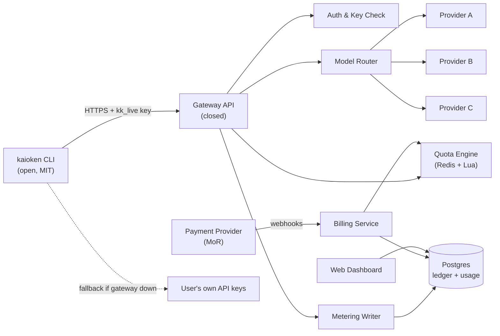
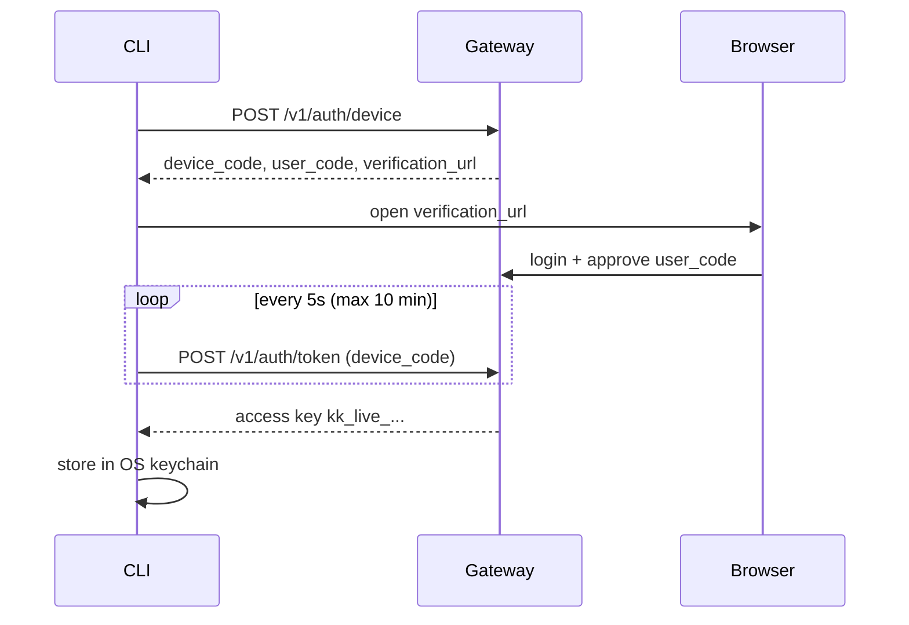
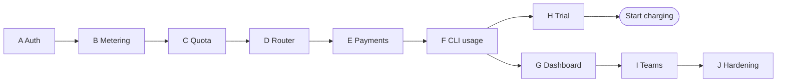

# 22. Billing & Gateway — Subscription Monetization

> **Status:** 🔵 Design Specification
> **Scope:** Hosted gateway, `kaioken connect`, plans, metering, quotas, payments
> **Depends on:** Doc 09 (Safety & Audit), Doc 13 (`audit show`), Doc 07 (CLI & Config)

---

## 1. Overview

Kaioken stays **open-source and free**. Money comes from the **hosted gateway**: users who do not want to manage API keys connect their CLI to the gateway and pay for subscription + metered tokens.

This is the same model Zed uses: free editor, paid hosted AI.

### 1.1 Principles

| # | Principle | Meaning |
|---|---|---|
| 1 | **BYOK is always free** | Users with their own API keys pay nothing, forever, with no feature crippling |
| 2 | **Open CLI, closed gateway** | Anything that runs on our servers is closed. Anything on the user's machine is MIT |
| 3 | **Pass-through pricing** | Tokens are billed at provider cost + markup. We never subsidize heavy users |
| 4 | **Hard caps by default** | No surprise bills. Overage must be opted into |
| 5 | **No prompt storage** | The gateway logs usage metadata, never prompts or code (see §12) |
| 6 | **Graceful fallback** | If the gateway is down, the CLI falls back to BYOK when keys exist |

### 1.2 What the gateway sells

| Product | Free (BYOK) | Paid (Gateway) |
|---|---|---|
| Full CLI, memory, review, docs, hooks | ✅ | ✅ |
| Hosted curated models (no keys needed) | ❌ | ✅ |
| Per-operation model routing | ✅ (manual) | ✅ (managed) |
| Cloud memory sync across machines | ❌ | ✅ |
| Usage dashboard & spend limits | ❌ | ✅ |
| Team shared memory & audit export | ❌ | Team+ |
| SSO, self-hosted gateway | ❌ | Enterprise |

---

## 2. Plans & Pricing

> Prices are **proposed**. Tune after the first 50 paying users.

| Plan | Price | Included credits | Overage | Seats |
|---|---|---|---|---|
| **Free** | $0 | None (BYOK only) | — | 1 |
| **Pro** | $12 / month | $5 in tokens | Opt-in, provider cost + 15% | 1 |
| **Team** | $25 / seat / month | $8 per seat, pooled | Opt-in, provider cost + 12% | 3+ |
| **Enterprise** | Custom | Custom | Custom | Custom |

### 2.1 Trial

| Item | Value |
|---|---|
| Length | 14 days |
| Credits | $10 in tokens |
| Card required | No |
| Premium models (Opus-class) | Excluded during trial |
| Abuse control | One trial per verified email + device fingerprint hash |

### 2.2 Unit economics (Pro, worst case)

| Line | Amount |
|---|---|
| Subscription revenue | $12.00 |
| Credits fully used ($5 billed, markup 15%) → provider cost | ≈ $4.35 |
| Payment provider fee (≈5% + $0.50, verify) | ≈ $1.10 |
| **Gross margin, worst case** | **≈ $6.55 (55%)** |
| Gross margin, user uses nothing | ≈ $10.90 |

Credits are denominated in **billed dollars**. Internal accounting stores provider cost separately (see §6).

---

## 3. Architecture



### 3.1 Repositories

| Repo | License | Contents |
|---|---|---|
| `kaioken` | MIT | CLI, `connect` client, usage display |
| `kaioken-gateway` | Closed | Auth, quota, router, metering, billing webhooks |
| `kaioken-dashboard` | Closed | Web UI for usage, plans, keys, team |

---

## 4. Authentication — `kaioken connect`

Uses the **device authorization flow**: no copying keys by hand, works over SSH.



### 4.1 Key rules

| Rule | Detail |
|---|---|
| Format | `kk_live_<32 random chars>` (prod), `kk_test_...` (sandbox) |
| Storage on server | SHA-256 hash only. The raw key is shown once |
| Storage on client | OS keychain (Keychain / Credential Manager / libsecret). Fallback: `~/.kaioken/credentials` with `0600` |
| Scope | One key per device. User can revoke any device from the dashboard |
| Rotation | `kaioken connect --rotate` |
| Env override | `KAIOKEN_API_KEY` for CI |

---

## 5. Metering

Every gateway request produces one **usage event**.

### 5.1 Usage event

| Field | Type | Notes |
|---|---|---|
| `id` | uuid | Idempotency key |
| `user_id` / `org_id` | uuid | Billing owner |
| `key_id` | uuid | Which device key |
| `operation` | enum | `chat`, `edit`, `review`, `verify`, `delegate`, `docs`, `research` |
| `model` | string | Resolved model name |
| `input_tokens` | int | |
| `cached_input_tokens` | int | Cache reads |
| `output_tokens` | int | |
| `provider_cost_micro` | int | Provider cost in micro-USD (1 USD = 1,000,000) |
| `billed_micro` | int | What the user is charged |
| `latency_ms` | int | |
| `status` | enum | `ok`, `error`, `refunded` |
| `created_at` | timestamp | |

### 5.2 Pricing formula

```
provider_cost = input * in_price + cached * cache_price + output * out_price
billed        = provider_cost * (1 + markup)
```

| Rule | Detail |
|---|---|
| Money type | Integer micro-USD everywhere. Never floats |
| Failed provider calls | Not billed |
| Partial streams | Billed for tokens actually delivered |
| Price table | Versioned in DB. Each event stores the price version used |

---

## 6. Quota & Credits Ledger

### 6.1 Ledger

Credits live in an **append-only ledger**. Balance = sum of entries.

| Entry type | Example |
|---|---|
| `grant_subscription` | +$5.00 at billing period start |
| `grant_trial` | +$10.00 |
| `topup` | +$20.00 (prepaid purchase) |
| `usage` | −$0.037 |
| `refund` | +$0.037 |
| `expire` | −unused subscription credits at period end |

| Rule | Detail |
|---|---|
| Subscription credits | Expire at period end (no rollover in v1) |
| Top-up credits | Never expire |
| Spend order | Subscription credits first, then top-up |

### 6.2 Atomic enforcement (Redis + Lua)

Checking and decrementing must happen in one atomic step, or concurrent requests overspend.

**Flow:** reserve estimated cost → call provider → settle with actual cost.

```lua
-- KEYS[1] = quota:{user_id}   (remaining micro-USD)
-- ARGV[1] = estimated_cost    (micro-USD)
local remaining = tonumber(redis.call('GET', KEYS[1]) or '0')
local est = tonumber(ARGV[1])
if remaining < est then
  return {0, remaining}          -- rejected
end
redis.call('DECRBY', KEYS[1], est)
return {1, remaining - est}      -- reserved
```

```lua
-- settle: KEYS[1] = quota:{user_id}
-- ARGV[1] = reserved, ARGV[2] = actual
local diff = tonumber(ARGV[1]) - tonumber(ARGV[2])
if diff ~= 0 then redis.call('INCRBY', KEYS[1], diff) end
return redis.call('GET', KEYS[1])
```

| Concern | Handling |
|---|---|
| Estimate too low | Cap `max_tokens` so worst-case cost ≤ reservation |
| Crash between reserve and settle | Reservation TTL job reconciles with the usage table |
| Redis data loss | Rebuild balance from the Postgres ledger on startup |
| Source of truth | **Postgres ledger.** Redis is only a fast cache |

### 6.3 Limits

| Limit | Default |
|---|---|
| Hard spend cap per period | Included credits only (overage off) |
| Overage | Opt-in, with user-set monthly cap |
| Rate limit | 60 req/min (Pro), 120 (Team) |
| Max concurrent requests | 4 (Pro), 10 (Team) |
| Low-balance warning | At 80% and 100% (CLI + email) |

---

## 7. Payments

### 7.1 Provider choice

A **merchant of record (MoR)** handles checkout, VAT and sales tax, and invoices. This matters because the founder is based in Morocco.

| Option | Pros | Cons |
|---|---|---|
| Merchant of record (Paddle, Lemon Squeezy, Polar, etc.) | Handles global tax, simple payouts | Higher fee (≈5% + $0.50), less control |
| Stripe via a US entity | Best tooling, lowest fee | Needs a legal entity and bank setup |
| Hybrid | Start with MoR, migrate later | Migration work |

> ⚠️ **Verify before building:** check which providers currently support payouts to Morocco. Stripe does not support Moroccan accounts directly, as far as known. Pick the provider first, then build the webhook layer against it. Keep the billing service behind a `PaymentProvider` interface so switching is cheap.

### 7.2 Subscription lifecycle

| Webhook event | Action |
|---|---|
| `checkout.completed` | Create subscription, grant credits, activate plan |
| `subscription.renewed` | Expire old credits, grant new period credits |
| `subscription.upgraded` / `downgraded` | Change entitlements, prorate per provider rules |
| `payment.failed` | Mark `past_due`, 7-day grace period, email user |
| `subscription.canceled` | Keep access until period end, then drop to Free |
| `refund.created` | Add refund ledger entry, reduce credits if unused |

| Rule | Detail |
|---|---|
| Idempotency | Every webhook stored by provider event id. Duplicates ignored |
| Signature check | Mandatory. Reject unsigned events |
| Past-due behaviour | Gateway returns `402` with a clear message. BYOK keeps working |

---

## 8. CLI Commands

```
kaioken
├── connect              # Device login to the gateway
│   ├── --rotate         # Replace this device's key
│   └── --status         # Show connection state
├── disconnect           # Remove local key (does not cancel plan)
├── whoami               # Account, plan, device name
├── usage                # Spend and credits this period
│   ├── --by-model       # Breakdown by model
│   ├── --by-operation   # Breakdown by operation
│   └── --json           # Machine-readable
├── plan                 # Show current plan and entitlements
├── billing              # Open customer portal in browser
└── topup <amount>       # Open checkout for prepaid credits
```

### 8.1 Example output

```
$ kaioken usage
Plan: Pro          Period: Nov 1 – Nov 30
Credits:  $5.00 included   $3.12 used   $1.88 left   (62%)
Top-up:   $0.00
Overage:  off

Top operations
  review    $1.40   (45%)
  chat      $0.98   (31%)
  verify    $0.74   (24%)
```

### 8.2 Behaviour when out of credits

| Situation | CLI behaviour |
|---|---|
| Credits at 80% | Warning line after each command |
| Credits exhausted, BYOK key present | Offer to switch to BYOK for this session |
| Credits exhausted, no BYOK | Show `kaioken topup` and `kaioken billing` hints, exit code `5` |
| Gateway unreachable | Retry twice, then BYOK fallback or clear error |

---

## 9. Gateway API

| Method | Endpoint | Purpose |
|---|---|---|
| POST | `/v1/auth/device` | Start device flow |
| POST | `/v1/auth/token` | Poll for key |
| POST | `/v1/chat` | Proxied model call (streaming) |
| GET | `/v1/usage` | Usage summary for current period |
| GET | `/v1/account` | Plan, entitlements, balance |
| GET | `/v1/models` | Models available on this plan |
| POST | `/v1/billing/portal` | Customer portal URL |
| POST | `/v1/billing/checkout` | Checkout URL (plan or top-up) |
| POST | `/webhooks/payments` | Provider webhooks (signed) |
| GET | `/healthz` | Health check |

### 9.1 Error codes

| HTTP | Code | Meaning |
|---|---|---|
| 401 | `invalid_key` | Key unknown or revoked |
| 402 | `credits_exhausted` | No credits and overage off |
| 402 | `payment_past_due` | Grace period ended |
| 403 | `plan_required` | Feature not in this plan |
| 429 | `rate_limited` | Includes `retry_after` |
| 502 | `provider_error` | Upstream failed, not billed |

---

## 10. Data Model

| Table | Key columns |
|---|---|
| `users` | id, email, created_at, trial_used |
| `orgs` | id, name, owner_id, plan_id |
| `memberships` | org_id, user_id, role (`owner`, `admin`, `member`) |
| `subscriptions` | id, org_or_user, plan_id, status, period_start, period_end, provider_ref |
| `api_keys` | id, user_id, key_hash, device_name, last_used_at, revoked_at |
| `credit_ledger` | id, account_id, type, amount_micro, ref_id, created_at |
| `usage_events` | see §5.1 |
| `price_table` | version, model, in_price, cache_price, out_price, effective_from |
| `webhook_events` | provider_event_id, payload_hash, processed_at |

---

## 11. Entitlements

Plans map to feature flags. The CLI asks `/v1/account` and caches for 10 minutes.

| Flag | Free | Pro | Team | Enterprise |
|---|---|---|---|---|
| `gateway_models` | ❌ | ✅ | ✅ | ✅ |
| `premium_models` | ❌ | ✅ | ✅ | ✅ |
| `cloud_sync` | ❌ | ✅ | ✅ | ✅ |
| `usage_dashboard` | ❌ | ✅ | ✅ | ✅ |
| `shared_memory` | ❌ | ❌ | ✅ | ✅ |
| `audit_export` | ❌ | ❌ | ✅ | ✅ |
| `sso` | ❌ | ❌ | ❌ | ✅ |
| `self_hosted_gateway` | ❌ | ❌ | ❌ | ✅ |

> The CLI must never block a local feature because the entitlement call failed. Unknown = allow local features, deny gateway features.

---

## 12. Privacy & Security

| Area | Rule |
|---|---|
| Prompt and code content | **Not stored.** Passed to the provider and discarded |
| What is logged | Usage metadata only (§5.1) |
| Provider retention | Use zero-retention endpoints where available |
| Transport | TLS only |
| Keys | Hashed at rest, shown once |
| Secrets in prompts | Optional redaction pass using the secrets scanner (see future feature list) |
| Admin access | Audit-logged. No routine access to user data |
| Abuse | Per-key rate limits, anomaly alert on spend spikes, auto-suspend on key leak reports |
| Compliance | Publish a plain-language privacy page before launch |

---

## 13. Failure Modes

| Failure | Impact | Mitigation |
|---|---|---|
| Gateway down | Paid users blocked | BYOK fallback, status page |
| Redis down | Cannot enforce quota | Fail closed for overage, fail open for small requests under a safety cap, rebuild from ledger |
| Provider outage | Model calls fail | Router fallback to equivalent model, no double billing |
| Webhook missed | Plan out of sync | Nightly reconciliation job against provider API |
| Double webhook | Double credit grant | Idempotency table |
| Clock skew on period end | Wrong credit window | Server-side time only |

---

## 14. Implementation Phases

| Phase | Deliverable | Est. |
|---|---|---|
| A | Gateway skeleton, device auth, `connect` / `whoami` | 5 days |
| B | Metering, price table, Postgres ledger | 4 days |
| C | Redis Lua quota, reserve/settle, rate limits | 4 days |
| D | Router, 2–3 providers, streaming proxy | 5 days |
| E | Payment provider integration, webhooks, plans | 6 days |
| F | `usage`, `plan`, `billing`, `topup` CLI commands | 3 days |
| G | Web dashboard (usage, keys, plan) | 7 days |
| H | Trial flow + abuse controls | 3 days |
| I | Team plan (orgs, seats, pooled credits) | 7 days |
| J | Load test, security review, launch docs | 5 days |

**Total:** ≈ 49 working days solo. Phases A–F + H are the minimum to start charging (~30 days).



---

## 15. Testing Checklist

| Area | Test |
|---|---|
| Quota | 100 concurrent requests never overspend balance |
| Quota | Crash after reserve → balance reconciles |
| Ledger | Sum of entries equals Redis balance after replay |
| Webhooks | Duplicate, out-of-order and unsigned events handled |
| Auth | Revoked key rejected within 1 minute |
| Billing | Failed payment → grace → downgrade path |
| Fallback | Gateway offline + BYOK key → CLI still works |
| Money | No float arithmetic anywhere (lint rule) |
| Privacy | Prompt text never appears in logs or DB |

---

## 16. Metrics to Track

| Metric | Why |
|---|---|
| MRR and paying users | Growth |
| Free → trial → paid conversion | Funnel health |
| Gross margin per token (billed − provider cost) | Pricing correctness |
| Credits used / granted ratio | Are included credits too generous or too small |
| Churn (monthly) | Retention |
| Gateway error rate and p95 latency | Product quality |
| BYOK vs gateway share | Whether the hosted offer is attractive |

---

## 17. Source Module Additions

| New Module | Repo | Purpose |
|---|---|---|
| `cli/connect` | kaioken | Device login, key storage |
| `cli/usage` | kaioken | Usage display |
| `cli/billing` | kaioken | Portal, plan, topup launchers |
| `gateway/client` | kaioken | Gateway HTTP client + BYOK fallback |
| `gateway/auth` | kaioken-gateway | Device flow, key issue/verify |
| `gateway/quota` | kaioken-gateway | Redis Lua scripts, reserve/settle |
| `gateway/router` | kaioken-gateway | Model routing, provider adapters |
| `gateway/meter` | kaioken-gateway | Usage events, ledger writer |
| `gateway/billing` | kaioken-gateway | Webhooks, `PaymentProvider` interface |

---

## 18. Open Decisions

| # | Question | Default until decided |
|---|---|---|
| 1 | Final payment provider (Morocco payout support) | MoR, behind an interface |
| 2 | Markup % (15% Pro / 12% Team) | As written |
| 3 | Subscription credit rollover | No rollover in v1 |
| 4 | Annual plan discount | 2 months free, add after launch |
| 5 | Student discount | 50% with university email |
| 6 | Regional pricing | Revisit after first 100 users |
| 7 | Whether Team needs shared-memory backend at launch | Ship Pro first, Team later |

---

## 19. Roadmap Impact

Add to the Doc 21 priority matrix:

| # | Feature | Doc | Complexity | Dependencies | Priority | Impact |
|---|---|---|---|---|---|---|
| 11 | Billing & Gateway | 22_billing_and_gateway.md | 🔴 High | Safety/audit modules | P1 — High | Revenue |

Add to the Doc 21 documentation index:

| # | Doc File | Topic | Status |
|---|---|---|---|
| 22 | 22_billing_and_gateway.md | Billing & Gateway | 🔵 Spec |